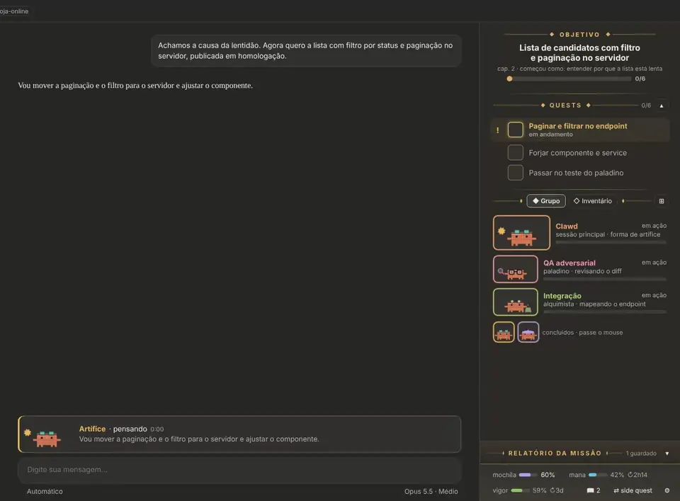
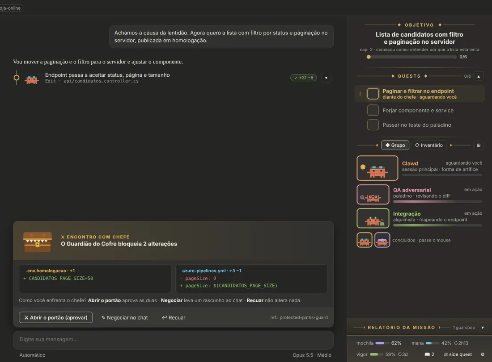
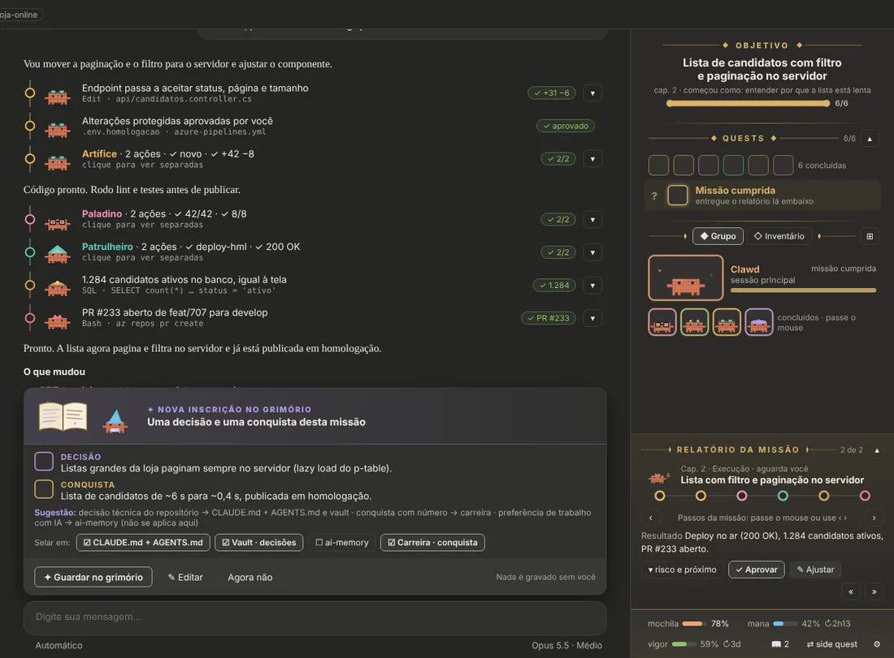
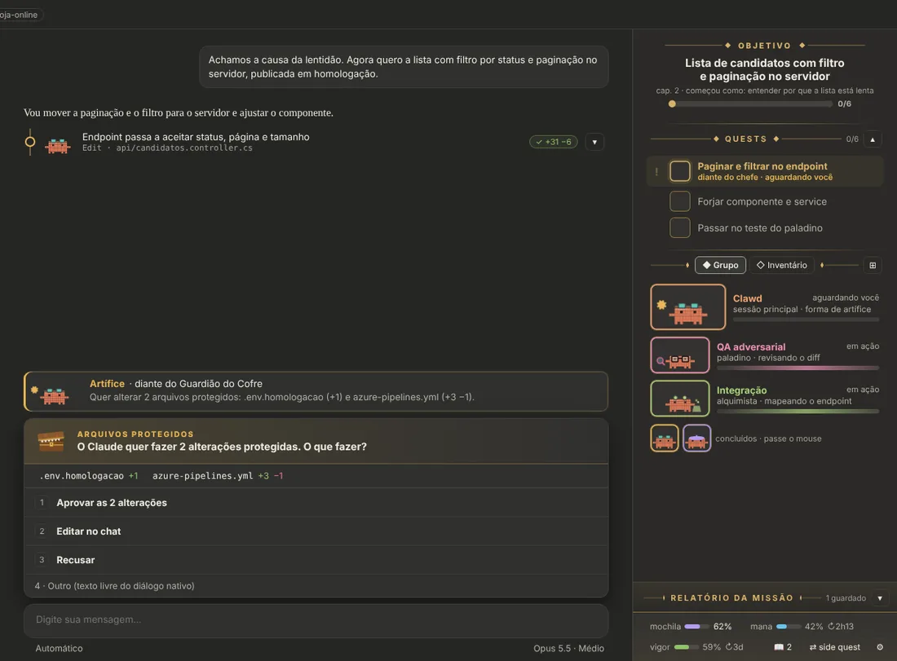
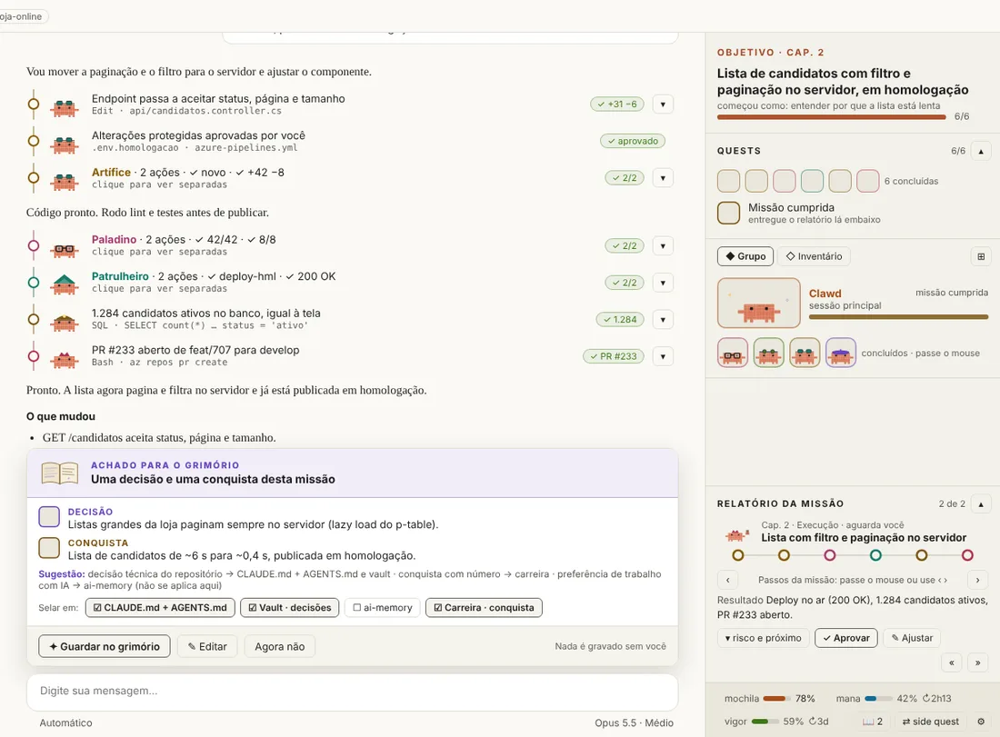
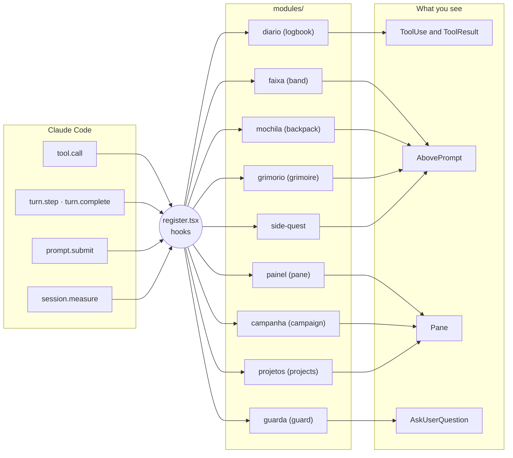

<div align="center">

<picture>
  <source media="(prefers-color-scheme: dark)" srcset="docs/assets/banner-escuro.svg">
  
</picture>

**A cozy RPG HUD for Claude Code: glance and know what Claude is doing, and never lose the objective.**

[](https://code.claude.com/docs/en/plugins/mods/overview)
[](mods/hero-journey)
[](#%EF%B8%8F-configuration)
[](#-tokens-and-privacy)
[](#%EF%B8%8F-development)
[](LICENSE)
[](#%EF%B8%8F-status-and-roadmap)

[Português](README.md) · **English**

[Demo](#-demo) · [Features](#-features) · [The party](#-the-party) · [Install](#-install) · [Configuration](#%EF%B8%8F-configuration) · [ai-memory](#-long-term-memory-with-ai-memory) · [How it works](#-how-it-works) · [Credits](#-credits-and-references)

</div>

> [!WARNING]
> **Beta.** The HUD was built for the Claude Code **desktop app** first. **Claude Code CLI** (terminal) support is still pending and comes after the desktop version. Expect rough edges, and [open an issue](https://github.com/soulrocha/Claude-code-hero-journey/issues) when you hit one.

---

## 🎬 Demo

<div align="center">



<sub>Reference prototype with fictional data, played at 2× speed. The real HUD draws with the app's own components, so the final look may differ slightly. The demo text is in Portuguese; the HUD also ships in English. The prototype shows CLAUDE.md and AGENTS.md ticked in the grimoire; in the HUD they come unticked.</sub>

</div>

## 🧭 Why it exists

Long Claude Code sessions turn into a wall of text: lots of tools running, little sense of the whole. **Hero Journey** turns the session into an RPG campaign without touching Claude's classic output.

- **Glance and know.** Each action gets its class (the Mage researches, the Artificer codes, the Paladin tests), with a mascot, a color and a short summary.
- **Never lose the objective.** The campaign objective, the chapter quests and each mission report stay pinned in the pane.
- **Read less.** Runs of actions collapse into one line ("Artificer · 2 actions · ✓ new · ✓ +42 −8"), and the report keeps only what matters.
- **Turn lessons into achievements.** The grimoire stores technical decisions, measurable wins and AI-work preferences where they belong, always on your click.

## ✨ Features

There are **10 modules**, each one toggled in the pane's ⚙.

| | Module | What it does |
|:-:|---|---|
| 📜 | **Logbook** | Puts the class mascot, a colored rail and a result chip on every tool row. Runs of the same class collapse into one group, and **Split ›** opens only that group. |
| 🎯 | **Band above the prompt** | While Claude works, shows the 90 px Clawd with its animated tool, the class, and the intent Claude wrote before calling tools. Hides when the turn ends. |
| 🗺️ | **Pane** (`/hero`) | Shows the objective, chapter quests, subagent party and file inventory, the report, and a footer with Backpack (context), Mana (5-hour window) and Vigor (weekly). |
| 📖 | **Campaign and report** | Treats the session as a campaign; each message opens a chapter. Each chapter ends with a report holding the timeline, result and risk, plus **✓ Approve** and **✎ Adjust**. |
| 🛡️ | **Protected-file guard** | Asks before Claude touches `.env`, pipelines or production `appsettings`, terminal commands included. Three modes, including the **boss encounter** with the Vault Guardian. Fails closed. |
| 🎒 | **Backpack** | Past 85% context, sends the `/compact` instruction to your prompt, or compacts right away while Claude is idle. |
| ✒️ | **Grimoire** | Finds the turn's decisions, wins and preferences, suggests where to store each one (vault, career, ai-memory; CLAUDE.md and AGENTS.md only if you tick them), and writes only when you click **Seal**. |
| ⇄ | **Side quest** | Starts a detour in a parallel session: the request goes to your prompt with the campaign summary attached. |
| 🗂 | **Projects** (`/projetos`) | Projects with several folders, pinned ones on top, and the current folder's project highlighted. Shows which folders Claude can reach (✓/✗) and grants access for the session (`/add-dir`) or for good (`.claude/settings.local.json`), with one click. |
| 🎉 | **Celebration** | The Clawd cheers when a mission ends without failures. |

Beyond the modules, the HUD speaks **English and Portuguese** (it follows Claude's language, or you pin one) and has **two skins**: **Epic** (a WoW-style quest log with ◆ ornaments and "!" and "?" marks) and **Sober**. Both follow the light or dark theme.

### Gallery

<table>
  <tr>
    <td width="50%"><br><sub><b>Vault Guardian.</b> The protected files' diffs side by side, with Open the gate, Negotiate and Retreat.</sub></td>
    <td width="50%"><br><sub><b>Mission end.</b> The grouped logbook, the grimoire card and the report with its timeline.</sub></td>
  </tr>
  <tr>
    <td width="50%"><br><sub><b>Default protection.</b> Claude's own dialog, with the files and their +/− on top.</sub></td>
    <td width="50%"><br><sub><b>Sober skin, light theme.</b> The same HUD with fewer ornaments.</sub></td>
  </tr>
</table>

## 🦀 The party

The pixel-art **Clawd** crabs come in nine classes, each with a hat and an animated tool. The class comes from the tool and the file or command: `npm test` is a Paladin, `azure-pipelines.yml` a Ranger, `git push` a Herald.

<table>
  <tr>
    <td align="center" width="33%"><picture><source media="(prefers-color-scheme: dark)" srcset="docs/assets/classes/druida-escuro.svg"></picture><br><b>Clawd druid</b><br><sub>Main session, plans and tasks</sub></td>
    <td align="center" width="33%"><picture><source media="(prefers-color-scheme: dark)" srcset="docs/assets/classes/mago-escuro.svg"></picture><br><b>Mage</b><br><sub>Reading, search and research · grimoire</sub></td>
    <td align="center" width="33%"><picture><source media="(prefers-color-scheme: dark)" srcset="docs/assets/classes/ilusionista-escuro.svg"></picture><br><b>Illusionist</b><br><sub>UI, prototypes and design</sub></td>
  </tr>
  <tr>
    <td align="center"><picture><source media="(prefers-color-scheme: dark)" srcset="docs/assets/classes/artifice-escuro.svg"></picture><br><b>Artificer</b><br><sub>Code</sub></td>
    <td align="center"><picture><source media="(prefers-color-scheme: dark)" srcset="docs/assets/classes/paladino-escuro.svg"></picture><br><b>Paladin</b><br><sub>Tests, lint and review</sub></td>
    <td align="center"><picture><source media="(prefers-color-scheme: dark)" srcset="docs/assets/classes/patrulheiro-escuro.svg"></picture><br><b>Ranger</b><br><sub>Pipelines, deploys and logs</sub></td>
  </tr>
  <tr>
    <td align="center"><picture><source media="(prefers-color-scheme: dark)" srcset="docs/assets/classes/anao-escuro.svg"></picture><br><b>Dwarf miner</b><br><sub>Databases and migrations</sub></td>
    <td align="center"><picture><source media="(prefers-color-scheme: dark)" srcset="docs/assets/classes/arauto-escuro.svg"></picture><br><b>Herald</b><br><sub>Commit, push, PR and merge</sub></td>
    <td align="center"><picture><source media="(prefers-color-scheme: dark)" srcset="docs/assets/classes/alquimista-escuro.svg"></picture><br><b>Alchemist</b><br><sub>Integrations (MCP, HTTP)</sub></td>
  </tr>
</table>

In the inventory, each file gets a rarity by its impact:

| Rarity | File |
|---|---|
| 🟧 **Legendary** | Protected |
| 🟦 **Rare** | Created |
| 🟩 **Uncommon** | Modified |
| ⬜ **Poor** | Deleted |

## 🚀 Install

> [!NOTE]
> Requires the **Claude Code desktop app** with mods (function hooks) enabled. The tests run on engine 2.1.293; older versions may refuse parts of the screen.

**On Windows, from a local clone** (PowerShell; runs the tests before installing):

```powershell
git clone https://github.com/soulrocha/Claude-code-hero-journey.git
cd Claude-code-hero-journey
powershell -ExecutionPolicy Bypass -File scripts\instalar.ps1 -Lingua en
```

With a vault: add `-Vault` with its path and, for an inbox folder other than `Inbox`, `-VaultInbox` with the subfolder name.

**From the marketplace:**

```
/plugin install hero-journey --marketplace soulrocha/Claude-code-hero-journey
```

A mod installed from the terminal at user scope also loads in the desktop app's sessions. Then type **`/hero`**.

**Coming from v0.4 (`clawd-hud`)?** The plugin was renamed. Remove the old one first, so you do not end up with two HUDs and two guards: `claude plugin uninstall clawd-hud@claude-code-hero-journey`. `scripts\instalar.ps1` does this on its own.

**What the install asks.** The mod's options are the questions below, and all of them can stay empty. To answer them:
- **inside Claude Code:** `/plugin configure hero-journey@claude-code-hero-journey`;
- **from a terminal:** `claude plugin install hero-journey@claude-code-hero-journey --config vaultPath=C:\Notes --config vaultInbox=Inbox --config language=en`, or later `claude plugin configure hero-journey@claude-code-hero-journey`.

The terminal install does not ask the questions by itself: it only lists the options left unset. Restart Claude Code after changing an option.

| Question | If you use it | If you don't |
|---|---|---|
| HUD language | `auto`, `pt-BR` or `en` | leave `auto` |
| Do you use a vault (Obsidian)? | its path, e.g. `C:\Notes` | leave empty |
| Vault inbox folder | the subfolder where new notes land | keep the default, `Inbox` |
| Extra protected / always-allowed globs | comma-separated globs | leave empty |

ai-memory needs no folder: the grimoire writes to it over MCP, when that MCP is connected (see [its section](#-long-term-memory-with-ai-memory)).

**First steps.** The first time the pane opens, it asks the same questions as a short wizard:
- the language;
- whether you use a vault, where it is and which inbox folder to use (folders are checked before saving);
- whether to add the current folder as a project.

The same screen recommends what is missing: with no vault it suggests [Obsidian](https://obsidian.md); with no ai-memory MCP it suggests [ai-memory](https://github.com/akitaonrails/ai-memory). When it is connected, it shows "✓ ai-memory connected".

You can get back to it from ⚙ → ✦ First steps.

<details>
<summary><b>Run straight from the folder while developing (Windows, desktop app)</b></summary>

1. Clone the repository.
2. In `%USERPROFILE%\.claude\settings.json`, inside `"env"`, point at the mod folder in your clone:
   ```json
   "CLAUDE_CODE_PLUGIN_DIRS": "C:\\path\\to\\clone\\mods\\hero-journey",
   "CLAUDE_CODE_PLUGIN_DIR_WATCH": "1"
   ```
3. Restart the app and type `/hero`. Saving a file reloads the mod.

</details>

## ⚙️ Configuration

**In `/config`:**

| Option | Default | What for |
|---|---|---|
| `language` | `auto` | Follows Claude's language; `pt-BR` or `en` pin it |
| `protect` | — | Extra protected globs, comma-separated |
| `allow` | — | Globs the guard never blocks (e.g. `.env.example`) |
| `vaultPath` | — | Vault folder, for the grimoire's vault and career destinations |
| `vaultInbox` | `Inbox` | Vault subfolder where the grimoire drops new notes |

**In the pane's ⚙** (saved across sessions):
- modules and language;
- skin;
- pane profile (Full, Focus, Minimal or Custom) and the sections it shows;
- logbook grouped or separate;
- protection mode;
- the grimoire's Haiku button;
- First steps.

> [!NOTE]
> **What about the app's sidebar?** The mod API cannot change the native sidebar: it is not among the components a mod can redraw, and there is no call to rename or group sessions. That's why projects, their folders and the access to them live in the HUD's pane (🗂 in the footer, or `/projetos`).

Each module's details, known limits and code layout are in the [mod's README](mods/hero-journey/README.md), which is in Portuguese with an English summary.

## 🔒 Tokens and privacy

- **Drawing, git reads, timers and groups never call the model.** Only two things spend tokens, and only on your click: **Compact now** (backpack) and **✦ Summarize with Haiku** (grimoire, an optional button that is off by default).
- **The grimoire writes nothing until you click Seal.** CLAUDE.md and AGENTS.md become standing instructions for Claude, so they come **unticked**: they get something only if you tick them. Even then they get a single line, with no backticks or tags. Text that mentions the vault or a personal path is left out.
- **A note never overwrites a note.** If the name is taken, the new one gets `-2`, `-3`… An inscription that was written nowhere stays pending, with the reason in the notice.
- **With no vault and no ai-memory,** the grimoire offers only CLAUDE.md and AGENTS.md, unticked, and points to where both extensions are set up.
- **The guard fails closed.** If the check breaks, the edit is blocked.
- **Folder access only on click.** The Projects module writes `.claude/settings.local.json` only when you ask, and only adds folders, never removes. If the file is not valid JSON, it is left alone.

## 🧠 Long-term memory with ai-memory

The grimoire's **ai-memory** destination uses [**ai-memory**](https://github.com/akitaonrails/ai-memory) by **Fabio Akita** ([@akitaonrails](https://github.com/akitaonrails)), MIT-licensed. It gives coding agents long-term memory: it keeps what happens in your sessions, hands the right context back in the next one, and holds a profile of your preferences that applies across projects. Thank you, Akita, for opening it up. If ai-memory helps you, support it: star [its repository](https://github.com/akitaonrails/ai-memory) and tell people who work with coding agents.

**How the HUD talks to it.** Over MCP, the way ai-memory's docs recommend for external tools. No loose files in a folder:
- when ai-memory's MCP is connected in the session, the destination shows up in the grimoire; without the MCP it is hidden, and First steps recommends installing it;
- a **preference** ("I prefer short answers") goes to your **profile** (`memory_write_page` with `scope: "profile"`), under `workflow/`. Older versions without the profile get `scope: "global"`;
- a **decision** or an **achievement** goes to ai-memory only if you tick that destination. It becomes a page of the current project, under `decisions/` or `notes/`;
- the time goes into the page name, because `memory_write_page` replaces a page with the same path.

**Alongside Obsidian.** The two complement each other:
- the **vault** holds what you write and review: decisions, results, career notes;
- **ai-memory** holds what the agent has to remember on its own: session history, handoffs and your preferences;
- the HUD's grimoire is the bridge: the decision goes to the vault and the preference goes to ai-memory, always on a click.

If your vault is also an ai-memory project, use `ignore_paths` in `.ai-memory.toml` to keep sensitive folders out of capture.

## 🧩 How it works

The HUD is a Claude Code **mod**: a plugin of *function hooks*, where each hook receives the engine's event, decides, and passes it on.



- **One file wires everything.** All code that uses `$` (the engine interface) lives in `register.tsx`, because the engine does not follow `$` across imports.
- **Each module has its own folder:** pure logic in `<module>.ts`, the screen in `view.tsx`.
- **The art is SVG text,** animated with CSS and SMIL and with no script, which is what the desktop's interactive `Svg` draws.

## 🛠️ Development

```sh
# Validate and test everything (spends no tokens)
./scripts/verificar.sh                                       # macOS/Linux
powershell -ExecutionPolicy Bypass -File scripts\verificar.ps1   # Windows

# Regenerate the banner and class icons
bun run scripts/gerar-assets.ts
```

There are 85 HUD tests and 5 spike tests. They run inside Claude Code's own engine (`claude plugin test`) on the desktop and terminal surfaces, and include a regression test for every finding of the adversarial QA and of the PR review. The animated demo and the screens were recorded from the reference prototype, which is not part of this repository.

Want to help? Read [CONTRIBUTING](CONTRIBUTING.md). Found a security issue? Follow the [security policy](SECURITY.md). Each release's changes are in the [CHANGELOG](CHANGELOG.md).

## 🗺️ Status and roadmap

> [!IMPORTANT]
> **Beta, desktop app first.** Everything passes the validator and the engine tests, but the full manual test in the desktop app is still in progress. The spike (`mods/clawd-hud-spike`) is there to confirm in the real app what tests cannot reach, such as SVG animation and the pinned footer. CLI (terminal) support comes after the desktop version.

- [x] Design: prototypes v1–v6 and final, reviewed by UX and adversarial QA
- [x] Phase 0: spike probing the 12 items to validate
- [x] Phase 1: logbook, band and pane, with zero tokens
- [x] Phase 2: campaign, mission report and protected-file guard
- [x] Phase 3: grimoire, backpack with compaction, side quest and celebration
- [x] Portuguese and English, toggleable modules, adversarial QA with fixes
- [x] Projects with several folders and access, First steps, MIT license
- [x] PR review fixes: terminal guard, inventory with `-z`, no-overwrite grimoire and ai-memory over MCP
- [ ] Full manual test in the desktop app, and adjustments from it
- [ ] First stable release
- [ ] Claude Code CLI (terminal) support, after the desktop version

## 🙏 Credits and references

The HUD's code is its own, but it stands on others' work.

**Code patterns** from the [**claude-code-templates**](https://github.com/davila7/claude-code-templates) mods by **Daniel (San) Ávila**, MIT-licensed. Each module credits its source in its header, and the license notice is in [`THIRD_PARTY_NOTICES.md`](mods/hero-journey/THIRD_PARTY_NOTICES.md).

| Source mod | What it inspired |
|---|---|
| [protected-paths-guard](https://github.com/davila7/claude-code-templates/tree/main/cli-tool/components/mods/security/protected-paths-guard) | Globs and the fail-closed guard |
| [large-edit-confirmation](https://github.com/davila7/claude-code-templates/tree/main/cli-tool/components/mods/security/large-edit-confirmation) | Asking through the dialog before editing |
| [tool-timing-badge](https://github.com/davila7/claude-code-templates/tree/main/cli-tool/components/mods/ui/tool-timing-badge) | Wrapping the tool row |
| [agent-flow](https://github.com/davila7/claude-code-templates/tree/main/cli-tool/components/mods/ui/agent-flow) | Tracking subagents |
| [git-sidebar](https://github.com/davila7/claude-code-templates/tree/main/cli-tool/components/mods/ui/git-sidebar) | Shell-free git for the inventory |
| [session-time-machine](https://github.com/davila7/claude-code-templates/tree/main/cli-tool/components/mods/productivity/session-time-machine) | The session timeline |

**Mods that pair well with the HUD.** Install them from their authors' repositories: [secret-redactor](https://github.com/davila7/claude-code-templates/tree/main/cli-tool/components/mods/security/secret-redactor) and [prompt-cache-control](https://github.com/davila7/claude-code-templates/tree/main/cli-tool/components/mods/observability/prompt-cache-control).

**References**
- Claude Code mods docs: [code.claude.com/docs/en/plugins/mods/overview](https://code.claude.com/docs/en/plugins/mods/overview)
- Official examples: [anthropics/claude-code · mods](https://github.com/anthropics/claude-code/tree/main/mods)
- [ai-memory](https://github.com/akitaonrails/ai-memory) by Fabio Akita: the grimoire's long-term memory destination
- [Tabler Icons](https://tabler.io/icons), used in the prototype
- The quest-log look is inspired by World of Warcraft, Baldur's Gate 3 and Diablo

> [!NOTE]
> A fan project, **not affiliated with Anthropic**. Clawd is Claude Code's mascot; here it only got hats and gear. World of Warcraft, Baldur's Gate 3 and Diablo belong to their owners and appear only as inspiration.

## 👤 Author

Made by **Saulo Rocha**, a developer (Angular, .NET and Azure DevOps).

[](https://www.linkedin.com/in/soulrocha)
[](https://github.com/soulrocha)

## 📄 License

[MIT](LICENSE) © 2026 Saulo Rocha. The parts adapted from claude-code-templates keep their original MIT notice in [`THIRD_PARTY_NOTICES.md`](mods/hero-journey/THIRD_PARTY_NOTICES.md).

<div align="center">
<br>
<sub>🦀 ✦ Safe travels, hero.</sub>
</div>
