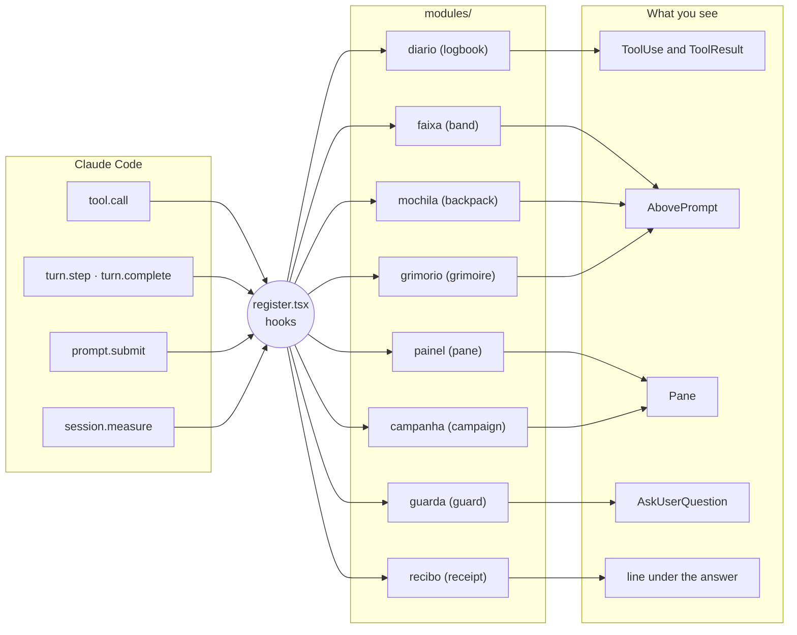

<div align="center">

<picture>
  <source media="(prefers-color-scheme: dark)" srcset="docs/assets/banner-escuro.svg">
  
</picture>

**A cozy RPG HUD for Claude Code: glance and know what Claude is doing, and never lose the objective.**

[](https://code.claude.com/docs/en/plugins/mods/overview)
[](mods/hero-journey)
[](#%EF%B8%8F-configuration)
[](#-tokens-and-privacy)
[](https://github.com/soulrocha/Claude-code-hero-journey/actions/workflows/ci.yml)
[](LICENSE)
[](#%EF%B8%8F-status-and-roadmap)

**English** · [Português](README.pt-BR.md)

[Quick start](#-quick-start) · [Demo](#-demo) · [Features](#-features) · [The party](#-the-party) · [Install](#-install) · [Configuration](#%EF%B8%8F-configuration) · [ai-memory](#-long-term-memory-with-ai-memory) · [How it works](#-how-it-works) · [Credits](#-credits-and-references)

</div>

> [!WARNING]
> **1.0, stable.** The HUD works in the **desktop app** and in the **Claude Code CLI** (terminal), each with the drawing its medium allows. Found something off? [Open an issue](https://github.com/soulrocha/Claude-code-hero-journey/issues) when you hit one.

---

## 🎬 Demo

<div align="center">


<sub>A short session, looping, with sample data. The art is the mod's own (the Clawds, the stage, the dragon), laid out as in the desktop app; the text is in Portuguese, and the HUD also ships in English.</sub>

</div>

## ⚡ Quick start

In the Claude Code desktop app (2.1.295 or later), run:

```
/plugin install hero-journey --marketplace soulrocha/Claude-code-hero-journey
```

Then type **`/hero`** to open the pane. Every option can stay empty, and nothing spends tokens unless you click it. Details, the Windows script and the options are in [Install](#-install).

## 🧭 Why it exists

Long Claude Code sessions turn into a wall of text: lots of tools running, little sense of the whole. **Hero Journey** turns the session into an RPG campaign without touching Claude's classic output.

- **Glance and know.** Each action gets its class (the Mage reads, the Rune Caster writes code, the Witcher hunts bugs), with Clawd dressed for the part, a color, a scene and a short summary.
- **Never lose the objective.** The campaign objective, the steps done and the quests left stay pinned in the pane, and in miniature in the band above the prompt.
- **Read less.** The pane shows only what has content; the plan, party and inventory appear when they exist, and the rest of the room goes to the stage.
- **Continue where you stopped.** The grimoire saves your progress (the task in a file, plus an ai-memory handoff when available) to continue later in any agent, and keeps decisions, achievements and rules where they belong, always on your click.

## ✨ Features

There are **8 modules**, each one toggled in the pane's ⚙.

| | Module | What it does |
|:-:|---|---|
| 📜 | **Logbook** | On every tool row while the turn runs: the class Clawd up front (in its failure pose when something fails), who acted and on what, and the result on the right, as plain text with no border ("1.0s ✓", "+12 −3 ✓", "failed ✗"), with the mark always in the same column. When the turn ends, the app itself folds the rows into "Ran N actions", and the receipt stays. |
| 🎯 | **Band above the prompt** | One line: during the turn, the class Clawd, who acts and the file in use, in its rarity color; with a plan, the step trail; when idle, **Your turn**, or the subagents "on expedition". It never repeats the chat sentence. The turn spinner names the class too ("Mage reading art.ts"). A badge shows up only when a resource runs low (🎒 Backpack 92%, 💧 Mana 8%). The **Panel ›** in the corner opens and closes the pane. |
| 🗺️ | **Pane** (`/hero`) | The **stage** on top: the class at work in its own scene, the Apprentice thinking or the camp (awake on your turn, asleep when the session goes idle) → the objective, from the title the app gives the session → only when they exist: the plan, the party on expedition and the inventory → and, pinned to the bottom, the resources and the buttons. With no plan, party or inventory, the stage grows. |
| 📖 | **Campaign** | Treats the session as a campaign: the first message sets the objective, and each message opens a chapter that closes when the turn ends. It feeds the objective bar and the receipt. Haiku can recalibrate the objective, on your click. |
| 🧾 | **Turn receipt** | One line under the answer: who acted most, how many actions, +/−, new files, failures and the time. When the turn completes its mission without failures, the mission leads the line: "🦀 ✦ Mission complete: …". Zero tokens. |
| 🛡️ | **Protected-file guard** | A red dragon stops Claude before it touches a critical file, the kind that, misconfigured, takes down the app, the database or the API: `.env`, pipelines and workflows, production and staging `appsettings`, keys, certificates and Terraform state. It holds even in auto mode, and for terminal commands that would write those files. It shows the change and asks: Approve, Edit in chat or Refuse. The list is short on purpose, so the warning keeps its weight. Fails closed. |
| 🎒 | **Resources: Backpack, Mana and Vigor** | At the bottom of the pane, one row each. The **Backpack** measures the context up to the point where Claude Code compacts on its own, names its state (Light, Loaded, Heavy, Overflowing) and, on hover, shows last turn's weight and what is taking up room. **Mana** (5-hour window) and **Vigor** (weekly) show what is left, a live countdown to the reset, the spending pace, and warn once when they reach 10%. Past 85% of the backpack, a card above the prompt offers to save progress and compact; clicking the Backpack in the footer opens the same card any time. |
| ✒️ | **Grimoire** | The Sage keeps three things: **save progress** (the task in a file and an ai-memory handoff, to **Continue** later in any agent or PC), the **chronicle** (decisions and achievements, in the vault or `docs/decisoes`) and the **rules** (one line in `AGENTS.md`). It gathers silently during the turn, nudges on the stage and only asks above the prompt at a milestone and before compacting. Each inscription has one destination, nothing is written until **✦ Seal in the grimoire**, and a seal can be undone. |

Beyond the modules, the HUD speaks **English and Portuguese** (it follows Claude's language, or you pin one) and has **two styles**: **Epic** (a WoW-style quest log with ◆ ornaments and "!" and "?" marks) and **Sober**. Both follow the light or dark theme.

### Gallery

<table>
  <tr>
    <td width="40%" rowspan="2"><br><sub><b>Stage.</b> The class at work in its scene, who acts, the file and the objective.</sub></td>
    <td width="60%"><br><sub><b>Guard.</b> The dragon stops a critical file and shows the change before you choose.</sub></td>
  </tr>
  <tr>
    <td width="60%"><br><sub><b>Band and backpack.</b> Who acts and the plan trail; a heavy backpack offers to save progress and compact.</sub></td>
  </tr>
  <tr>
    <td colspan="2"><br><sub><b>Logbook.</b> The class Clawd on every tool row and the result on the right; on failure, it stumbles.</sub></td>
  </tr>
</table>

<sub>Screens drawn by the mod itself, with sample data. The interface is shown in Portuguese.</sub>

### In the terminal


In the Claude Code CLI the HUD uses what the terminal can draw:

- **The Clawds are pixel art made for the terminal,** with no background, each wearing what it wears on the desktop (hat, crown, shield, bow…). The stage shows in the pane docked beside the conversation (fullscreen, 110 columns or more), large when the pane is free and smaller with a plan, party or inventory. The camp has the campfire, and the stage is animated: the Clawd breathes and the flame flickers.
- **Each class has an icon** (🔮 Mage, 🐺 Witcher, 🎭 Illusionist…) wherever only one line fits: the band, the logbook (to the right of each tool row), the spinner and the receipt, which takes the place of "Baked for 3s".
- **A resource on alert** also shows at the end of the hint line under the prompt.
- **What differs from the desktop:** without the docked pane there is no stage (the pane opens above the prompt, text only); the guard shows 🐉 instead of the dragon art, since the engine allows only 12 rows around the dialog and no pixels there; the spinner is drawn by the mod and does not show tokens; tooltips become written text.

## 🦀 The party

The pixel-art **Clawd** crabs wear **19 classes**, one for each kind of Claude task, each with its own outfit, tool and scene, and two poses: at work and when something goes wrong. The class comes from the tool and the file or command: `npm test` is the Witcher, `azure-pipelines.yml` is the Artificer, `git push` is the King and `git status` is the Mage. The full map is in [docs/classes.md](docs/classes.md) (Portuguese).

<table>
  <tr>
    <td align="center" width="25%"><br><b>Apprentice</b><br><sub>Thinks and answers · the main one</sub></td>
    <td align="center" width="25%"><br><b>Mage</b><br><sub>Reads and searches the project</sub></td>
    <td align="center" width="25%"><br><b>Hunter</b><br><sub>Researches the web</sub></td>
    <td align="center" width="25%"><br><b>Rogue</b><br><sub>Browses websites</sub></td>
  </tr>
  <tr>
    <td align="center" width="25%"><br><b>Rune Caster</b><br><sub>Writes code</sub></td>
    <td align="center" width="25%"><br><b>Illusionist</b><br><sub>Screens and style</sub></td>
    <td align="center" width="25%"><br><b>Sage</b><br><sub>Docs and writing · keeps the grimoire</sub></td>
    <td align="center" width="25%"><br><b>Engineer</b><br><sub>Terminal commands</sub></td>
  </tr>
  <tr>
    <td align="center" width="25%"><br><b>Witcher</b><br><sub>Tests, lint and types</sub></td>
    <td align="center" width="25%"><br><b>King</b><br><sub>Commit, PR and merge · talks to the world</sub></td>
    <td align="center" width="25%"><br><b>Artificer</b><br><sub>Pipeline, deploy and infra</sub></td>
    <td align="center" width="25%"><br><b>Oracle</b><br><sub>Logs and monitoring</sub></td>
  </tr>
  <tr>
    <td align="center" width="25%"><br><b>Geomancer</b><br><sub>Databases and migrations</sub></td>
    <td align="center" width="25%"><br><b>Alchemist</b><br><sub>APIs and integrations (MCP, HTTP)</sub></td>
    <td align="center" width="25%"><br><b>Cartomancer</b><br><sub>Plans and tasks</sub></td>
    <td align="center" width="25%"><br><b>Summoner</b><br><sub>Calls subagents</sub></td>
  </tr>
  <tr>
    <td align="center" width="25%"><br><b>Chronomancer</b><br><sub>Schedules and automates</sub></td>
    <td align="center" width="25%"><br><b>Paladin</b><br><sub>Security and review</sub></td>
    <td align="center" width="25%"><br><b>Painter</b><br><sub>Visual design</sub></td>
  </tr>
</table>

<sub>The game references (D&D, World of Warcraft, The Witcher, Expedition 33, Tree of Savior, Final Fantasy XIV) and Avatar are tributes: the one wearing each class is always Clawd, with none of their names or logos in the product.</sub>

When Claude stops, the Apprentice goes back to **camp**:

<table>
  <tr>
    <td width="50%"><br><sub><b>Awake:</b> the turn ended and it is your turn.</sub></td>
    <td width="50%"><br><sub><b>Asleep:</b> the session has been idle for a few minutes.</sub></td>
  </tr>
</table>

In the inventory, each file gets a rarity by its impact, and clicking it opens its diff:

| Rarity | File |
|---|---|
| 🟧 **Legendary** | Protected |
| 🟦 **Rare** | Created |
| 🟩 **Uncommon** | Modified |
| ⬜ **Poor** | Deleted |

## 🚀 Install

> [!NOTE]
> Requires the **Claude Code desktop app** with mods (function hooks) enabled. The tests run on engine 2.1.295; older versions may refuse parts of the screen.

**On Windows, from a local clone** (PowerShell; runs the tests before installing):

```powershell
git clone https://github.com/soulrocha/Claude-code-hero-journey.git
cd Claude-code-hero-journey
powershell -ExecutionPolicy Bypass -File scripts\instalar.ps1 -Lingua en
```

With a vault: add `-Vault` with its path and, for an inbox folder other than `Inbox`, `-VaultInbox` with the subfolder name.

**From the marketplace:**

```
/plugin install hero-journey --marketplace soulrocha/Claude-code-hero-journey
```

A mod installed from the terminal at user scope also loads in the desktop app's sessions. Then type **`/hero`**.

**Coming from v0.4 (`clawd-hud`)?** The plugin was renamed. Remove the old one first, so you do not end up with two HUDs and two guards: `claude plugin uninstall clawd-hud@claude-code-hero-journey`. `scripts\instalar.ps1` does this on its own.

**What the install asks.** The mod's options are the questions below, and all of them can stay empty. To answer them:
- **inside Claude Code:** `/plugin configure hero-journey@claude-code-hero-journey`;
- **from a terminal:** `claude plugin install hero-journey@claude-code-hero-journey --config vaultPath=C:\Notes --config vaultInbox=Inbox --config language=en`, or later `claude plugin configure hero-journey@claude-code-hero-journey`.

The terminal install does not ask the questions by itself: it only lists the options left unset. Restart Claude Code after changing an option.

| Question | If you use it | If you don't |
|---|---|---|
| HUD language | `auto`, `pt-BR` or `en` | leave `auto` |
| Do you use a vault (Obsidian)? | its path, e.g. `C:\Notes` | leave empty |
| Vault inbox folder | the subfolder where new notes land | leave empty: when you pick the vault in the pane, it is found on its own (`00-Inbox` if it exists, otherwise `Inbox`) |
| Extra protected / always-allowed globs | comma-separated globs | leave empty |

ai-memory needs no folder: the grimoire writes to it over MCP, when that MCP is connected (see [its section](#-long-term-memory-with-ai-memory)).

**First steps.** The first time the pane opens, it says everything already works and only asks for the language. Below, it shows what it found for memory:
- **Vault:** the folder, if it is already set, or **📁 Choose folder**, which opens the system's folder picker (the folder is checked before saving, and the inbox folder is found on its own). The field to type the path only shows up if the picker does not open.
- **ai-memory:** "connected", with an invitation to support Fabio Akita, or "not found", with a link to learn about [ai-memory](https://github.com/akitaonrails/ai-memory).

None of it is required: without a vault or ai-memory, progress and decisions stay in the project itself, and the grimoire asks when it needs to. You can get back to the screen from ⚙ → First steps.

<details>
<summary><b>Run straight from the folder while developing (Windows, desktop app)</b></summary>

1. Clone the repository.
2. In `%USERPROFILE%\.claude\settings.json`, inside `"env"`, point at the mod folder in your clone:
   ```json
   "CLAUDE_CODE_PLUGIN_DIRS": "C:\\path\\to\\clone\\mods\\hero-journey",
   "CLAUDE_CODE_PLUGIN_DIR_WATCH": "1"
   ```
3. Restart the app and type `/hero`. Saving a file reloads the mod.

</details>

## ⚙️ Configuration

**In `/config`:**

| Option | Default | What for |
|---|---|---|
| `language` | `auto` | Follows Claude's language; `pt-BR` or `en` pin it |
| `protect` | — | Extra protected globs, comma-separated |
| `allow` | — | Globs the guard never blocks (the `.env.example`, `.env.sample` and `.env.template` templates are already allowed) |
| `vaultPath` | — | Vault folder, for the grimoire's vault and career destinations |
| `vaultInbox` | `Inbox` | Vault subfolder where the grimoire drops new notes |

**In the pane's ⚙** (saved across sessions), in two groups: **General** (language and style) and **Features** (each module, grouped by where it shows up; under the Grimoire, **⚙ Memory ›**; under the Guard, its mode: **Ask** or **Only warn**). First steps and About sit at the bottom; About shows the 19 classes, with what each one does on hover.

In **⚙ Memory** (also from 📖): each grimoire feature and prompt, where decisions go, the integrations (vault and ai-memory) and the Haiku button.

> [!NOTE]
> **What about the app's sidebar?** The mod API cannot change the native sidebar: it is not among the components a mod can redraw, and there is no call to rename or group sessions.

Each module's details, known limits and code layout are in the [mod's README](mods/hero-journey/README.md), which is in Portuguese with an English summary.

## 🔒 Tokens and privacy

- **Drawing, git reads, timers and groups never call the model.** Only three things spend tokens, and only on your click: **Compact now** (backpack), **✦ Recalibrate objective** (pane, through Haiku) and **✦ Summarize with Haiku** (grimoire, an optional button that is off by default).
- **The grimoire writes nothing until you click Seal,** and a seal can be undone. Only a rule you set yourself ("from now on…") goes to `AGENTS.md`, as a single line with no backticks or tags. Text that mentions the vault or a personal path never goes into the repository.
- **A note never overwrites a note.** If the name is taken, the new one gets `-2`, `-3`… An inscription that was written nowhere stays pending, with the reason in the notice.
- **With no vault and no ai-memory,** everything works with the project: the task in `.hero/tarefas/` (kept out of git by its own `.gitignore`), decisions in `docs/decisoes` (the first one asks before) and rules in `AGENTS.md`.
- **The guard fails closed.** If the check breaks, the edit is blocked.
- **Resources and receipt cost nothing.** The numbers come from Claude Code itself (`$.session.usage()`), and the backpack's breakdown is estimated locally, with no token-count call.

## 🧠 Long-term memory with ai-memory

The grimoire uses [**ai-memory**](https://github.com/akitaonrails/ai-memory) by **Fabio Akita** ([@akitaonrails](https://github.com/akitaonrails)), MIT-licensed. It gives coding agents long-term memory: it keeps what happens in your sessions, hands the right context back in the next one, and passes work between agents (Claude, Codex, Antigravity and others) and between PCs. Thank you, Akita, for opening it up. If ai-memory helps you, support it: star [its repository](https://github.com/akitaonrails/ai-memory) and tell people who work with coding agents.

**The recommended setup.** It is what research and the tools' own docs point to for people who use more than one agent:
- **`AGENTS.md`** with each project's rules, kept short: Codex, Antigravity and Claude Code read the same file;
- **the task in a file** (objective, next step, how to verify, what failed and a log), which any agent can pick up;
- **ai-memory** for what the agent remembers on its own and for handoffs across tools and PCs;
- **an Obsidian vault** for what you review: decisions, results and career.

With the vault and ai-memory detected, ⚙ Memory shows "✓ Recommended setup detected" and the grimoire comes set up. Without them, everything works with the project; each integration is suggested when you miss it.

**How the HUD talks to it.** Over MCP, the way ai-memory's docs recommend for external tools:
- **Save progress** writes the task and opens a handoff (`memory_handoff_begin`) with the next step and what is left of the plan;
- **Continue**, at camp, lists pending handoffs (`memory_handoff_list`) next to the project's tasks and claims the one you pick (`memory_handoff_accept`);
- a **decision** or an **achievement** goes to ai-memory only if you switch its destination to it: it becomes a page of the project, under `decisions/` or `notes/`, with the time in the name;
- **What the Sage remembers** shows recent pages (`memory_recent`), and "forget" marks them stale (`memory_feedback`), so bad memory does not make the agent worse;
- your preferences are learned by ai-memory itself, in its profile: the HUD neither detects nor writes preferences.

If your vault is also an ai-memory project, use `ignore_paths` in `.ai-memory.toml` to keep sensitive folders out of capture.

## 🧩 How it works

The HUD is a Claude Code **mod**: a plugin of *function hooks*, where each hook receives the engine's event, decides, and passes it on.



- **One file wires everything.** All code that uses `$` (the engine interface) lives in `register.tsx`, because the engine refuses `$` passed to an imported function ("$ is followed only into a function declared in this same file"). Checked on engine 2.1.295.
- **Each module has its own folder:** pure logic in `<module>.ts`, the screen in `view.tsx`.
- **The art is SVG text,** animated with CSS and SMIL and with no script, which is what the desktop's interactive `Svg` draws.

## 🛠️ Development

```sh
# Validate and test everything (spends no tokens)
./scripts/verificar.sh                                       # macOS/Linux
powershell -ExecutionPolicy Bypass -File scripts\verificar.ps1   # Windows

# Regenerate the banner, the class Clawds, the camp and the demo
bun run scripts/gerar-assets.ts
bun run scripts/gerar-demo.ts
```

There are 145 HUD tests and 5 spike tests. They run inside Claude Code's own engine (`claude plugin test`) on the desktop and terminal surfaces, and include a regression test for every finding of the adversarial QA and of the PR review. The demo and the gallery screens are drawn from the mod's own art.

Want to help? Read [CONTRIBUTING](CONTRIBUTING.md). Found a security issue? Follow the [security policy](SECURITY.md). Each release's changes are in the [CHANGELOG](CHANGELOG.md).

## 🗺️ Status and roadmap

> [!IMPORTANT]
> **1.0, stable.** Everything passes the validator and the engine tests, and the HUD was tested by hand in the desktop app. The spike (`mods/clawd-hud-spike`) stays as the place to confirm in the real app what tests cannot reach, such as SVG animation and the pinned footer.

- [x] Design: prototypes v1–v6 and final, reviewed by UX and adversarial QA
- [x] Phase 0: spike probing the 12 items to validate
- [x] Phase 1: logbook, band and pane, with zero tokens
- [x] Phase 2: campaign and protected-file guard (the mission report left the pane in the 2026-10-09 review)
- [x] Phase 3: grimoire, backpack with compaction, side quest and celebration (side quest and celebration left in the 2026-10-10 simplification)
- [x] Portuguese and English, toggleable modules, adversarial QA with fixes
- [x] First steps, MIT license
- [x] PR review fixes: terminal guard, inventory with `-z`, no-overwrite grimoire and ai-memory over MCP
- [x] Simplification (2026-10-10, [scope, in Portuguese](docs/escopo.md)): Projects, Side quest, logbook grouping, pane profiles and the report code are gone; the three art files became one
- [x] Better resources: Backpack measured against the compaction point, state in words, last-turn weight (in the tooltip), live countdowns, warnings and pace for Mana and Vigor, footer pinned to the bottom
- [x] Turn receipt in place of the report and the celebration, with zero tokens
- [x] The HUD comes back right after `/clear`, `/resume` and `/branch`
- [x] Vault with the system folder picker and a shortcut to the decisions folder
- [x] 0.6: 19 classes, one per task family ([map](docs/classes.md)), each with a background-free Clawd (work and failure) and its own scene; the Apprentice and the camp
- [x] 0.6: pane with the stage on top and sections only when they have content; one-line band; class spinner; logbook with just the pet
- [x] 0.6: new grimoire: save progress and continue, chronicle, rules in AGENTS.md, ⚙ Memory and the recommended setup detected on its own
- [x] 0.6: screens reviewed: First steps with no folder questions, ⚙ in General and Features, About with the 19 classes, the guard with the red dragon and a short protected list, logbook without the app rail, light theme checked
- [x] 0.6: in-app test, quality review, new demo and the 0.6.0 release
- [x] 0.7: the HUD in the Claude Code CLI (terminal): the 19 Clawds as purpose-made pixel art, the animated stage in the pane, each class icon in the band, logbook, spinner and receipt
- [x] 0.7: a steadier grimoire (no stuck Seal, no duplicate notes) and clearer compaction
- [x] 1.0: manual test in the desktop app, with the fixes from it
- [x] 1.0: diffs in the inventory
- [x] 1.0: first stable release

## 🙏 Credits and references

The HUD's code is its own, but it stands on others' work.

**Code patterns** from the [**claude-code-templates**](https://github.com/davila7/claude-code-templates) mods by **Daniel (San) Ávila**, MIT-licensed. Each module credits its source in its header, and the license notice is in [`THIRD_PARTY_NOTICES.md`](mods/hero-journey/THIRD_PARTY_NOTICES.md).

| Source mod | What it inspired |
|---|---|
| [protected-paths-guard](https://github.com/davila7/claude-code-templates/tree/main/cli-tool/components/mods/security/protected-paths-guard) | Globs and the fail-closed guard |
| [large-edit-confirmation](https://github.com/davila7/claude-code-templates/tree/main/cli-tool/components/mods/security/large-edit-confirmation) | Asking through the dialog before editing |
| [tool-timing-badge](https://github.com/davila7/claude-code-templates/tree/main/cli-tool/components/mods/ui/tool-timing-badge) | Wrapping the tool row |
| [agent-flow](https://github.com/davila7/claude-code-templates/tree/main/cli-tool/components/mods/ui/agent-flow) | Tracking subagents |
| [git-sidebar](https://github.com/davila7/claude-code-templates/tree/main/cli-tool/components/mods/ui/git-sidebar) | Shell-free git for the inventory |
| [session-time-machine](https://github.com/davila7/claude-code-templates/tree/main/cli-tool/components/mods/productivity/session-time-machine) | The session timeline |

**Mods that pair well with the HUD.** Install them from their authors' repositories: [secret-redactor](https://github.com/davila7/claude-code-templates/tree/main/cli-tool/components/mods/security/secret-redactor) and [prompt-cache-control](https://github.com/davila7/claude-code-templates/tree/main/cli-tool/components/mods/observability/prompt-cache-control). To hand a long session off to a fresh one, [ctx-handoff](https://github.com/cablate/ctx-handoff-mod) and [claude-auto-handoff](https://github.com/alexknowshtml/claude-auto-handoff) do what the side quest did.

**References**
- Claude Code mods docs: [code.claude.com/docs/en/plugins/mods/overview](https://code.claude.com/docs/en/plugins/mods/overview)
- Official examples: [anthropics/claude-code · mods](https://github.com/anthropics/claude-code/tree/main/mods)
- [ai-memory](https://github.com/akitaonrails/ai-memory) by Fabio Akita: the grimoire's long-term memory and cross-agent handoff
- [Tabler Icons](https://tabler.io/icons), used in the prototype
- The quest-log look is inspired by World of Warcraft, Baldur's Gate 3 and Diablo

> [!NOTE]
> A fan project, **not affiliated with Anthropic**. Clawd is Claude Code's mascot; here it only got hats and gear. World of Warcraft, Baldur's Gate 3 and Diablo belong to their owners and appear only as inspiration.

## 👤 Author

Made by **Saulo Rocha**, a developer (Angular, .NET and Azure DevOps).

**Also by the author:** [SnapMD](https://github.com/soulrocha/snapmd), a Chrome and Edge extension that turns the page you are looking at (form state, grids, terminals, modals) into LLM-ready Markdown. Its popup mascot is this project's Rogue.

[](https://www.linkedin.com/in/soulrocha)
[](https://github.com/soulrocha)

## 📄 License

[MIT](LICENSE) © 2026 Saulo Rocha. The parts adapted from claude-code-templates keep their original MIT notice in [`THIRD_PARTY_NOTICES.md`](mods/hero-journey/THIRD_PARTY_NOTICES.md).

<div align="center">
<br>
<sub>🦀 ✦ Safe travels, hero.</sub><br>
<sub>If Hero Journey made your sessions more fun, a ⭐ helps other adventurers find it.</sub>
</div>
