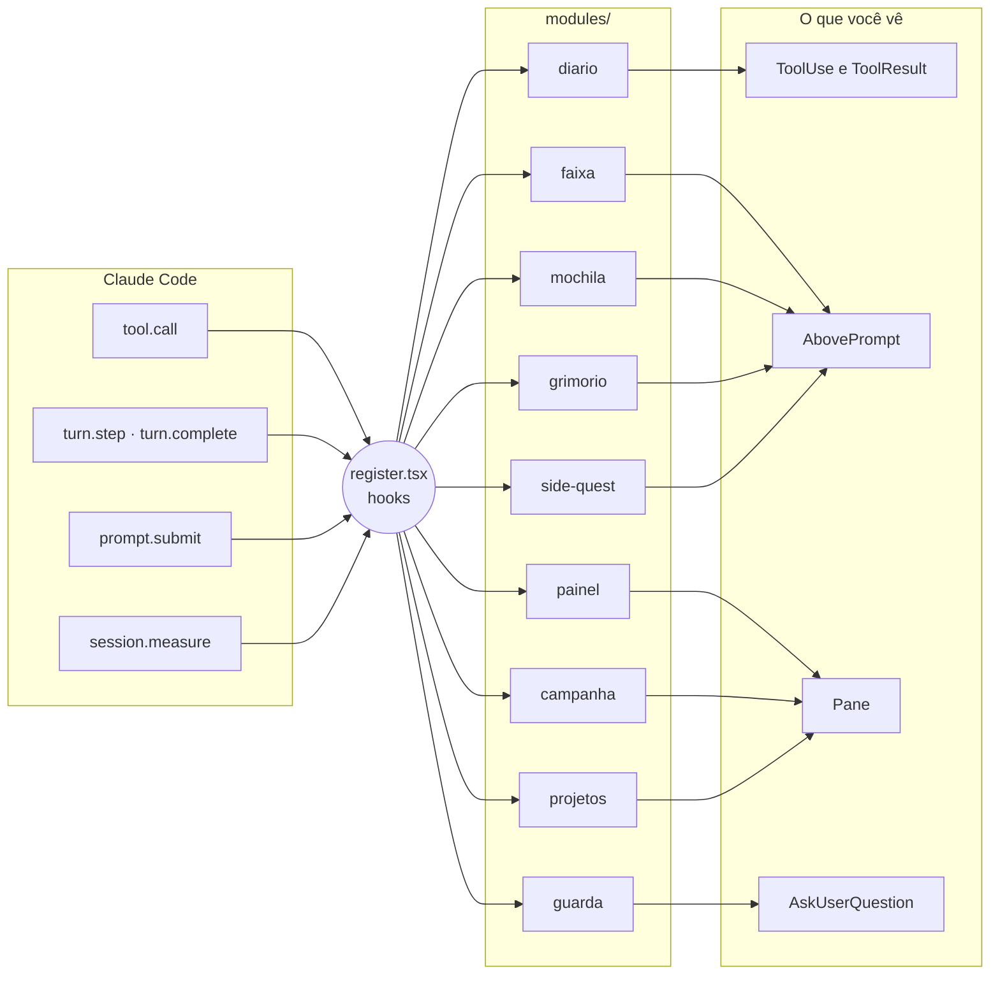

<div align="center">

<picture>
  <source media="(prefers-color-scheme: dark)" srcset="docs/assets/banner-escuro.svg">
  
</picture>

**Uma HUD de RPG aconchegante para o Claude Code: bata o olho e saiba o que o Claude está fazendo, sem perder o objetivo.**

[](https://code.claude.com/docs/en/plugins/mods/overview)
[](mods/hero-journey)
[](#%EF%B8%8F-configuração)
[](#-tokens-e-privacidade)
[](#%EF%B8%8F-desenvolvimento)
[](LICENSE)
[](#%EF%B8%8F-status-e-roadmap)

**Português** · [English](README.en.md)

[Demo](#-demo) · [Recursos](#-recursos) · [O grupo](#-o-grupo) · [Instalação](#-instalação) · [Configuração](#%EF%B8%8F-configuração) · [ai-memory](#-memória-de-longo-prazo-com-o-ai-memory) · [Como funciona](#-como-funciona) · [Créditos](#-créditos-e-referências)

</div>

> [!WARNING]
> **Beta.** A HUD foi feita primeiro para o **app desktop** do Claude Code. O suporte ao **Claude Code CLI** (terminal) ainda está pendente e vem depois da versão desktop. Espere arestas, e [abra uma issue](https://github.com/soulrocha/Claude-code-hero-journey/issues) quando achar uma.

---

## 🎬 Demo

<div align="center">


<sub>Protótipo de referência, com dados fictícios e em velocidade 2×. A HUD de verdade desenha com os componentes do app, então a aparência final pode variar um pouco. No protótipo, o grimório aparece com o CLAUDE.md e o AGENTS.md marcados; na HUD, eles vêm desmarcados.</sub>

</div>

## 🧭 Por que existe

Sessões longas com o Claude Code viram uma parede de texto: muita ferramenta rodando, pouca noção do todo. O **Hero Journey** transforma a sessão numa campanha de RPG sem mexer na saída clássica do Claude.

- **Bater o olho:** cada ação ganha a classe certa (o Mago pesquisa, o Artífice codifica, o Paladino testa), com mascote, cor e um resumo curto.
- **Não perder o objetivo:** o objetivo da campanha, as quests do capítulo e o relatório de cada missão ficam fixos no painel.
- **Ler menos:** as ações seguidas viram um grupo ("Artífice · 2 ações · ✓ novo · ✓ +42 −8"), e o relatório traz só o que importa.
- **Transformar aprendizado em conquista:** o grimório guarda decisões técnicas, conquistas com número e preferências de trabalho com IA nos lugares certos, sempre com o seu clique.

## ✨ Recursos

São **10 módulos**, e cada um liga e desliga no ⚙ do painel.

| | Módulo | O que faz |
|:-:|---|---|
| 📜 | **Diário de bordo** | Mascote da classe, trilho colorido e chip de resultado em cada ferramenta. As ações seguidas da mesma classe viram um grupo, e **Separar ›** abre só aquele. |
| 🎯 | **Faixa acima do prompt** | Enquanto o Claude trabalha: o Clawd de 90 px com o acessório animado, a classe e a intenção que ele escreveu antes das ferramentas. Some no fim do turno. |
| 🗺️ | **Painel** (`/hero`) | Objetivo → quests do capítulo → grupo de subagentes e inventário de arquivos → relatório → rodapé com Mochila (contexto), Mana (janela de 5h) e Vigor (semanal). |
| 📖 | **Campanha e relatório** | A sessão vira uma campanha, e cada mensagem abre um capítulo. No fim, o relatório traz a linha do tempo, o resultado, o risco e os botões **✓ Aprovar** e **✎ Ajustar**. |
| 🛡️ | **Guarda dos protegidos** | Pergunta antes de mexer em `.env`, pipelines e `appsettings` de produção, inclusive por comando de terminal. Tem três modos, um deles o **encontro com chefe** com o Guardião do Cofre. Se algo der errado, bloqueia. |
| 🎒 | **Mochila** | Quando o contexto passa de 85%, leva a instrução do `/compact` ao prompt, ou compacta na hora com o Claude parado. |
| ✒️ | **Grimório** | Acha as decisões, as conquistas e as preferências do turno, sugere onde guardar (vault, carreira, ai-memory; CLAUDE.md e AGENTS.md só se você marcar) e grava só no **Selar**. |
| ⇄ | **Side quest** | Um desvio numa sessão paralela: o pedido vai ao prompt já com o resumo da campanha. |
| 🗂 | **Projetos** (`/projetos`) | Projetos com várias pastas, os fixados no topo e o projeto da pasta atual em destaque. Mostra a que pastas o Claude tem acesso (✓/✗) e libera o acesso na sessão (`/add-dir`) ou de vez (`.claude/settings.local.json`), com um clique. |
| 🎉 | **Comemoração** | O Clawd festeja quando uma missão termina sem falha. |


Além dos módulos, a HUD fala **português e inglês** (segue a língua do Claude, ou você fixa uma) e tem **duas peles**: **Épico** (quest log ao estilo WoW, com ornamentos ◆, "!" e "?") e **Sóbrio**. As duas acompanham o tema claro ou escuro.

### Galeria

<table>
  <tr>
    <td width="50%"><br><sub><b>Guardião do Cofre.</b> Os diffs dos protegidos lado a lado, com Abrir o portão, Negociar e Recuar.</sub></td>
    <td width="50%"><br><sub><b>Fim da missão.</b> O diário agrupado, o cartão do grimório e o relatório com a linha do tempo.</sub></td>
  </tr>
  <tr>
    <td width="50%"><br><sub><b>Proteção padrão.</b> O diálogo do próprio Claude, com os arquivos e o +/− por cima.</sub></td>
    <td width="50%"><br><sub><b>Pele Sóbrio, tema claro.</b> A mesma HUD com menos ornamento.</sub></td>
  </tr>
</table>

## 🦀 O grupo

Os caranguejos **Clawd** em pixel art: nove classes, cada uma com chapéu e acessório animado. A classe sai da ferramenta e do arquivo ou comando (`npm test` é Paladino, `azure-pipelines.yml` é Patrulheiro, `git push` é Arauto).

<table>
  <tr>
    <td align="center" width="33%"><picture><source media="(prefers-color-scheme: dark)" srcset="docs/assets/classes/druida-escuro.svg"></picture><br><b>Clawd druida</b><br><sub>Sessão principal, planos e tarefas</sub></td>
    <td align="center" width="33%"><picture><source media="(prefers-color-scheme: dark)" srcset="docs/assets/classes/mago-escuro.svg"></picture><br><b>Mago</b><br><sub>Leitura, busca e pesquisa · grimório</sub></td>
    <td align="center" width="33%"><picture><source media="(prefers-color-scheme: dark)" srcset="docs/assets/classes/ilusionista-escuro.svg"></picture><br><b>Ilusionista</b><br><sub>UI, protótipos e design</sub></td>
  </tr>
  <tr>
    <td align="center"><picture><source media="(prefers-color-scheme: dark)" srcset="docs/assets/classes/artifice-escuro.svg"></picture><br><b>Artífice</b><br><sub>Código</sub></td>
    <td align="center"><picture><source media="(prefers-color-scheme: dark)" srcset="docs/assets/classes/paladino-escuro.svg"></picture><br><b>Paladino</b><br><sub>Testes, lint e revisão</sub></td>
    <td align="center"><picture><source media="(prefers-color-scheme: dark)" srcset="docs/assets/classes/patrulheiro-escuro.svg"></picture><br><b>Patrulheiro</b><br><sub>Pipeline, deploy e logs</sub></td>
  </tr>
  <tr>
    <td align="center"><picture><source media="(prefers-color-scheme: dark)" srcset="docs/assets/classes/anao-escuro.svg"></picture><br><b>Anão minerador</b><br><sub>Banco de dados e migrações</sub></td>
    <td align="center"><picture><source media="(prefers-color-scheme: dark)" srcset="docs/assets/classes/arauto-escuro.svg"></picture><br><b>Arauto</b><br><sub>Commit, push, PR e merge</sub></td>
    <td align="center"><picture><source media="(prefers-color-scheme: dark)" srcset="docs/assets/classes/alquimista-escuro.svg"></picture><br><b>Alquimista</b><br><sub>Integrações (MCP, HTTP)</sub></td>
  </tr>
</table>

No inventário, cada arquivo tem raridade pelo impacto:

| Raridade | Arquivo |
|---|---|
| 🟧 **Lendário** | Protegido |
| 🟦 **Raro** | Criado |
| 🟩 **Incomum** | Modificado |
| ⬜ **Pobre** | Excluído |

## 🚀 Instalação

> [!NOTE]
> Requer o **app desktop do Claude Code**, com mods (function hooks) ligados. Os testes rodam no motor 2.1.293; versões mais antigas podem recusar partes da tela.

**No Windows, pelo clone local** (PowerShell; roda os testes antes de instalar):

```powershell
git clone https://github.com/soulrocha/Claude-code-hero-journey.git
cd Claude-code-hero-journey
powershell -ExecutionPolicy Bypass -File scripts\instalar.ps1 -Lingua pt-BR
```

Com vault: acrescente `-Vault` com o caminho dele e, se quiser outra pasta de entrada que não `Inbox`, `-VaultInbox` com o nome da subpasta.

**Pelo marketplace:**

```
/plugin install hero-journey --marketplace soulrocha/Claude-code-hero-journey
```

Instalado pelo terminal no escopo de usuário, o mod também carrega nas sessões do app desktop. Depois, digite **`/hero`**.

**Vindo da v0.4 (`clawd-hud`)?** O plugin mudou de nome. Remova o antigo antes, para não ficar com duas HUDs e dois guardas: `claude plugin uninstall clawd-hud@claude-code-hero-journey`. O `scripts\instalar.ps1` já faz isso sozinho.

**O que a instalação pergunta.** As opções do mod são as perguntas abaixo. Todas podem ficar vazias. Para responder:
- **dentro do Claude Code:** `/plugin configure hero-journey@claude-code-hero-journey`;
- **pelo terminal:** `claude plugin install hero-journey@claude-code-hero-journey --config vaultPath=C:\Notas --config vaultInbox=Inbox --config language=pt-BR`, ou depois `claude plugin configure hero-journey@claude-code-hero-journey`.

A instalação pelo terminal não faz as perguntas sozinha: ela só avisa quais opções ficaram sem valor. Depois de mudar uma opção, reinicie o Claude Code.

| Pergunta | Se você usa | Se não usa |
|---|---|---|
| Língua da HUD | `auto`, `pt-BR` ou `en` | deixe `auto` |
| Você usa um vault (Obsidian)? | o caminho, ex.: `C:\Notas` | deixe vazio |
| Pasta de entrada no vault | a subpasta onde as notas novas caem | deixe o padrão, `Inbox` |
| Protegidos extras / Sempre liberados | globs separados por vírgula | deixe vazio |

O ai-memory não pede pasta: o grimório grava nele pelo MCP, quando o MCP está conectado (veja [a seção dele](#-memória-de-longo-prazo-com-o-ai-memory)).

**Primeiros passos.** Na primeira vez que o painel abre, ele mostra as mesmas perguntas em forma de assistente:
- a língua;
- se você usa um vault, onde ele fica e qual é a pasta de entrada (as pastas são conferidas antes de salvar);
- se quer cadastrar a pasta atual como projeto.

A mesma tela recomenda o que falta: sem vault, sugere o [Obsidian](https://obsidian.md); sem o MCP do ai-memory, sugere o [ai-memory](https://github.com/akitaonrails/ai-memory). Com ele conectado, mostra "✓ ai-memory conectado".

Dá para voltar a ele pelo ⚙ → ✦ Primeiros passos.

<details>
<summary><b>Rodar direto da pasta, durante o desenvolvimento (Windows, app desktop)</b></summary>

1. Clone o repositório.
2. Em `%USERPROFILE%\.claude\settings.json`, no bloco `"env"`, aponte para a pasta do mod no seu clone:
   ```json
   "CLAUDE_CODE_PLUGIN_DIRS": "C:\\caminho\\do\\clone\\mods\\hero-journey",
   "CLAUDE_CODE_PLUGIN_DIR_WATCH": "1"
   ```
3. Reinicie o app e digite `/hero`. Cada arquivo salvo recarrega o mod.

</details>

## ⚙️ Configuração

**Em `/config`:**

| Opção | Padrão | Para quê |
|---|---|---|
| `language` | `auto` | Segue a língua do Claude; `pt-BR` ou `en` fixam |
| `protect` | — | Globs extras protegidos, separados por vírgula |
| `allow` | — | Globs que o guarda nunca bloqueia (ex.: `.env.example`) |
| `vaultPath` | — | Pasta do vault, para os destinos do grimório e da carreira |
| `vaultInbox` | `Inbox` | Subpasta do vault onde o grimório deixa as notas novas |

**No ⚙ do painel** (guardado entre sessões): os módulos, a língua, a pele, o perfil do painel (Completo, Foco, Mínimo ou Personalizado), as seções que aparecem, o diário agrupado ou separado, o modo da proteção, o botão do Haiku no grimório e os Primeiros passos.

> [!NOTE]
> **E a barra lateral do app?** A API de mods não deixa mudar a barra lateral nativa: ela não está entre os componentes que um mod redesenha, e não há chamada para renomear ou agrupar sessões. Por isso os projetos, com as pastas e o acesso a elas, ficam no painel da HUD (🗂 no rodapé ou `/projetos`).

Detalhes de cada módulo, os limites conhecidos e a estrutura do código estão no [README do mod](mods/hero-journey/README.md).

## 🔒 Tokens e privacidade

- **Desenhar, ler o git, os timers e os grupos não chama o modelo.** Só duas coisas gastam tokens, e só quando você clica: **Compactar agora** (mochila) e **✦ Resumir com Haiku** (grimório, botão opcional que vem desligado).
- **O grimório não grava nada sem o seu clique em Selar.** O CLAUDE.md e o AGENTS.md viram instrução permanente do Claude, por isso vêm **desmarcados**: só recebem algo se você marcar. Mesmo assim, recebem uma linha só, sem crase nem tag. Um texto que cite o vault ou um caminho pessoal fica de fora.
- **Nota nunca sobrescreve nota:** se o nome já existe, a nova ganha `-2`, `-3`… E uma inscrição que não gravou em lugar nenhum continua pendente, com o motivo no aviso.
- **Sem vault e sem ai-memory,** o grimório oferece só o CLAUDE.md e o AGENTS.md, desmarcados, e lembra onde configurar as duas extensões.
- **O guarda falha fechado:** se a checagem quebrar, a edição é bloqueada.
- **Acesso a pastas só com clique:** o módulo Projetos só escreve no `.claude/settings.local.json` quando você pede, e só acrescenta pastas, sem apagar nada. Se o arquivo não for um JSON válido, ele não é sobrescrito.

## 🧠 Memória de longo prazo com o ai-memory

O destino **ai-memory** do grimório usa o [**ai-memory**](https://github.com/akitaonrails/ai-memory), de **Fabio Akita** ([@akitaonrails](https://github.com/akitaonrails)), sob licença MIT. Ele dá memória de longo prazo aos agentes de código: guarda o que acontece nas sessões, devolve o contexto certo na sessão seguinte e mantém um perfil com as suas preferências que vale em todos os projetos. Obrigado, Akita, por abrir o projeto. Se o ai-memory te ajudar, apoie: dê uma estrela [no repositório dele](https://github.com/akitaonrails/ai-memory) e conte para quem usa agentes de código.

**Como a HUD conversa com ele.** Pelo MCP, do jeito que a documentação do ai-memory recomenda para ferramentas externas. Não há arquivo solto numa pasta:
- quando o MCP do ai-memory está conectado na sessão, o destino aparece no grimório; sem o MCP, ele não aparece, e os Primeiros passos recomendam instalar;
- uma **preferência** ("prefiro respostas curtas") vai para o **perfil** (`memory_write_page` com `scope: "profile"`), na pasta `workflow/`. Nas versões mais antigas, que ainda não têm o perfil, vai com `scope: "global"`;
- uma **decisão** ou uma **conquista** só vai para o ai-memory se você marcar o destino. Ela vira uma página do projeto atual, em `decisions/` ou `notes/`;
- a hora entra no nome da página, porque `memory_write_page` substitui uma página de mesmo caminho.

**Junto com o Obsidian.** Os dois se completam:
- o **vault** guarda o que você escreve e revisa: decisões, resultados, notas de carreira;
- o **ai-memory** guarda o que o agente precisa lembrar sozinho: o histórico das sessões, os handoffs e as suas preferências;
- o grimório da HUD é a ponte: a decisão vai para o vault e a preferência vai para o ai-memory, sempre com um clique.

Se o vault também for um projeto do ai-memory, use o `ignore_paths` do `.ai-memory.toml` para deixar as pastas sensíveis fora da captura.

## 🧩 Como funciona

A HUD é um **mod** do Claude Code: um plugin de *function hooks*, em que cada hook recebe o evento, decide e passa adiante.



- **Um arquivo liga tudo:** todo código que usa `$` (a interface do motor) fica em `register.tsx`, porque o motor não segue o `$` através de imports.
- **Cada módulo tem a sua pasta**, com a lógica pura em `<módulo>.ts` e a tela em `view.tsx`.
- **A arte é texto de SVG** animado com CSS e SMIL, sem script: é o que o `Svg` interativo do desktop desenha.

<details>
<summary><b>Estrutura do repositório</b></summary>

```
.
├── mods/
│   ├── hero-journey/            # a HUD (o mod)
│   │   ├── hooks/
│   │   │   ├── register.tsx  # liga os módulos aos eventos
│   │   │   ├── core/         # arte, textos pt/en, classes, preferências
│   │   │   └── modules/      # diario, faixa, painel, campanha, guarda, mochila,
│   │   │                     # grimorio, side-quest, comemoracao, projetos
│   │   ├── tests/            # 85 testes no motor (desktop e terminal)
│   │   └── types/            # contrato do $.state
│   └── clawd-hud-spike/      # sondas para validar a API no app real
├── docs/                     # imagens do README e o estilo de saída briefing-de-bordo
├── scripts/                  # instalar, verificar, gerar assets
└── .claude-plugin/           # marketplace
```

</details>

## 🛠️ Desenvolvimento

```sh
# Valida e testa tudo (não gasta tokens)
./scripts/verificar.sh                                       # macOS/Linux
powershell -ExecutionPolicy Bypass -File scripts\verificar.ps1   # Windows

# Regenera o banner e os ícones das classes
bun run scripts/gerar-assets.ts
```

São 85 testes da HUD e 5 do spike. Eles rodam no motor do próprio Claude Code (`claude plugin test`), nas superfícies desktop e terminal, e incluem regressões para cada achado do QA adversarial e da revisão do PR. A demo animada e as telas foram gravadas a partir do protótipo de referência, que não faz parte deste repositório.

Quer contribuir? Leia o [CONTRIBUTING](CONTRIBUTING.md). Achou uma falha de segurança? Siga a [política de segurança](SECURITY.md). As mudanças de cada versão estão no [CHANGELOG](CHANGELOG.md).

## 🗺️ Status e roadmap

> [!IMPORTANT]
> **Beta, app desktop primeiro.** Tudo passa no validador e nos testes do motor, mas o teste manual completo no app desktop ainda está em andamento. O spike (`mods/clawd-hud-spike`) existe para confirmar no app real o que os testes não alcançam, como a animação dos Svgs e o rodapé fixo. O suporte ao CLI (terminal) vem depois da versão desktop.

- [x] Desenho: protótipos v1 a v6 e o final, validados por UX e por QA adversarial
- [x] Fase 0: spike com as sondas dos 12 itens a validar
- [x] Fase 1: diário, faixa e painel, sem tokens
- [x] Fase 2: campanha, relatório da missão e guarda dos protegidos
- [x] Fase 3: grimório, mochila com compactação, side quest e comemoração
- [x] Português e inglês, módulos que ligam e desligam, QA adversarial com correções
- [x] Projetos com várias pastas e acesso, Primeiros passos, licença MIT
- [x] Correções da revisão do PR: guarda do terminal, inventário com `-z`, grimório sem sobrescrita e ai-memory pelo MCP
- [ ] Teste manual completo no app desktop, e ajustes com o resultado
- [ ] Primeira versão estável
- [ ] Suporte ao Claude Code CLI (terminal), depois da versão desktop

## 🙏 Créditos e referências

O código da HUD é próprio, mas não nasceu do nada.

**Padrões de código.** Alguns padrões vieram dos mods do [**claude-code-templates**](https://github.com/davila7/claude-code-templates), de **Daniel (San) Ávila**, sob licença MIT. Cada módulo cita o padrão de origem no cabeçalho, e o aviso da licença está em [`THIRD_PARTY_NOTICES.md`](mods/hero-journey/THIRD_PARTY_NOTICES.md).

| Mod de origem | O que inspirou |
|---|---|
| [protected-paths-guard](https://github.com/davila7/claude-code-templates/tree/main/cli-tool/components/mods/security/protected-paths-guard) | Os globs e o guarda que falha fechado |
| [large-edit-confirmation](https://github.com/davila7/claude-code-templates/tree/main/cli-tool/components/mods/security/large-edit-confirmation) | Perguntar pelo diálogo antes de editar |
| [tool-timing-badge](https://github.com/davila7/claude-code-templates/tree/main/cli-tool/components/mods/ui/tool-timing-badge) | Embrulhar a linha de ferramenta |
| [agent-flow](https://github.com/davila7/claude-code-templates/tree/main/cli-tool/components/mods/ui/agent-flow) | Acompanhar os subagentes |
| [git-sidebar](https://github.com/davila7/claude-code-templates/tree/main/cli-tool/components/mods/ui/git-sidebar) | Git sem shell, no inventário |
| [session-time-machine](https://github.com/davila7/claude-code-templates/tree/main/cli-tool/components/mods/productivity/session-time-machine) | A linha do tempo da sessão |

**Mods que combinam com a HUD.** Instale do repositório de quem fez: [secret-redactor](https://github.com/davila7/claude-code-templates/tree/main/cli-tool/components/mods/security/secret-redactor) e [prompt-cache-control](https://github.com/davila7/claude-code-templates/tree/main/cli-tool/components/mods/observability/prompt-cache-control). Os créditos do auto-handoff (base da side quest) e dos outros mods adotados entram quando os links forem confirmados.

**Referências.**
- Documentação de mods do Claude Code: [code.claude.com/docs/en/plugins/mods/overview](https://code.claude.com/docs/en/plugins/mods/overview)
- Exemplos oficiais: [anthropics/claude-code · mods](https://github.com/anthropics/claude-code/tree/main/mods)
- [ai-memory](https://github.com/akitaonrails/ai-memory), de Fabio Akita: o destino de memória de longo prazo do grimório
- [Tabler Icons](https://tabler.io/icons), usados no protótipo
- A estética de quest log vem de World of Warcraft, Baldur's Gate 3 e Diablo

> [!NOTE]
> Projeto de fã, **sem afiliação com a Anthropic**. O Clawd é o mascote do Claude Code; aqui ele só ganhou chapéus e acessórios. World of Warcraft, Baldur's Gate 3 e Diablo pertencem aos seus donos e aparecem só como inspiração.

## 👤 Autor

Feito por **Saulo Rocha**, desenvolvedor (Angular, .NET e Azure DevOps).

[](https://www.linkedin.com/in/soulrocha)
[](https://github.com/soulrocha)

## 📄 Licença

[MIT](LICENSE) © 2026 Saulo Rocha. Os trechos adaptados do claude-code-templates mantêm o aviso MIT original em [`THIRD_PARTY_NOTICES.md`](mods/hero-journey/THIRD_PARTY_NOTICES.md).

<div align="center">
<br>
<sub>🦀 ✦ Boa jornada, herói.</sub>
</div>
