<div align="center">

<picture>
  <source media="(prefers-color-scheme: dark)" srcset="docs/assets/banner-escuro.svg">
  
</picture>

**Uma HUD de RPG aconchegante para o Claude Code: bata o olho e saiba o que o Claude está fazendo, sem perder o objetivo.**

[](https://code.claude.com/docs/en/plugins/mods/overview)
[](mods/hero-journey)
[](#%EF%B8%8F-configuração)
[](#-tokens-e-privacidade)
[](https://github.com/soulrocha/Claude-code-hero-journey/actions/workflows/ci.yml)
[](LICENSE)
[](#%EF%B8%8F-status-e-roadmap)

[English](README.md) · **Português**

[Começo rápido](#-começo-rápido) · [Demo](#-demo) · [Recursos](#-recursos) · [O grupo](#-o-grupo) · [Instalação](#-instalação) · [Configuração](#%EF%B8%8F-configuração) · [ai-memory](#-memória-de-longo-prazo-com-o-ai-memory) · [Como funciona](#-como-funciona) · [Créditos](#-créditos-e-referências)

</div>

> [!WARNING]
> **1.0, estável.** A HUD funciona no **app desktop** e no **Claude Code CLI** (terminal), cada um com o desenho que o seu meio permite. Achou algo estranho? [Abra uma issue](https://github.com/soulrocha/Claude-code-hero-journey/issues) quando achar uma.

---

## 🎬 Demo

<div align="center">


<sub>Uma sessão curta, em loop, com dados de exemplo. A arte é a do próprio mod (os Clawds, o palco, o dragão), montada como no app desktop; o texto vai em português, e a HUD também fala inglês.</sub>

</div>

## ⚡ Começo rápido

No app desktop do Claude Code (2.1.295 ou mais novo), rode:

```
/plugin install hero-journey --marketplace soulrocha/Claude-code-hero-journey
```

Depois digite **`/hero`** para abrir o painel. Todas as opções podem ficar vazias, e nada gasta token sem o seu clique. Detalhes, script para Windows e opções estão em [Instalação](#-instalação).

## 🧭 Por que existe

Sessões longas com o Claude Code viram uma parede de texto: muita ferramenta rodando, pouca noção do todo. O **Hero Journey** transforma a sessão numa campanha de RPG sem mexer na saída clássica do Claude.

- **Bater o olho:** cada ação ganha a classe certa (o Mago lê, o Rúnico escreve código, o Bruxo caça bugs), com o Clawd vestido a caráter, cor, cenário e um resumo curto.
- **Não perder o objetivo:** o objetivo da campanha, os passos feitos e as quests que faltam ficam fixos no painel e, em miniatura, na faixa acima do prompt.
- **Ler menos:** o painel mostra só o que tem conteúdo; plano, grupo e inventário aparecem quando existem, e o resto do espaço é do palco.
- **Continuar de onde parou:** o grimório salva o progresso (a tarefa num arquivo, e o handoff no ai-memory quando há) para continuar depois, em qualquer agente, e guarda decisões, conquistas e regras nos lugares certos, sempre com o seu clique.

## ✨ Recursos

São **8 módulos**, e cada um liga e desliga no ⚙ do painel.

| | Módulo | O que faz |
|:-:|---|---|
| 📜 | **Diário de bordo** | Em cada ferramenta, enquanto o turno roda: o Clawd da classe em destaque (na falha, com a pose de falha), quem agiu e o quê, e o resultado à direita, em texto e sem borda ("1.0s ✓", "+12 −3 ✓", "falhou ✗"), com o símbolo sempre na mesma coluna. No fim do turno, o próprio app recolhe as linhas em "Executado N ações", e o recibo fica. |
| 🎯 | **Faixa acima do prompt** | Uma linha: durante o turno, o Clawd da classe, quem age e o arquivo em uso, na cor da raridade; com plano, a trilha dos passos; parado, **Sua vez**, ou os subagentes "em expedição". Nunca repete a frase do chat. O spinner do turno também diz a classe ("Mago lendo art.ts"). Um selo aparece só quando um recurso entra em alerta (🎒 Mochila 92%, 💧 Mana 8%). O **Painel ›** do canto abre e fecha o painel. |
| 🗺️ | **Painel** (`/hero`) | O **palco** no topo: a classe em ação no seu cenário, o Aprendiz pensando ou o acampamento (acordado na sua vez, dormindo quando a sessão para) → o objetivo, pelo título que o app dá à sessão → só quando existem: o plano, o grupo em expedição e o inventário → e, presos no fim, os recursos e os botões. Sem plano, grupo nem inventário, o palco cresce. |
| 📖 | **Campanha** | A sessão vira uma campanha: a primeira mensagem dá o objetivo, e cada mensagem abre um capítulo que fecha no fim do turno. É dela que saem a barra do objetivo e o recibo. O objetivo pode ser recalibrado pelo Haiku, com um clique. |
| 🧾 | **Recibo do turno** | Uma linha embaixo da resposta: quem mais agiu, quantas ações, +/−, arquivos novos, falhas e o tempo. Quando o turno cumpre a missão sem falha, ela abre a linha: "🦀 ✦ Missão cumprida: …". Zero tokens. |
| 🛡️ | **Guarda dos protegidos** | Um dragão vermelho barra o Claude antes de mexer num arquivo crítico, aqueles que, mal configurados, derrubam a aplicação, o banco ou a API: `.env`, pipelines e workflows, `appsettings` de produção e homologação, chaves, certificados e o estado do Terraform. Vale até no modo automático e também para comando de terminal que escreveria neles. Mostra a mudança e pergunta: Aprovar, Editar no chat ou Recusar. A lista é curta de propósito, para o aviso não perder o peso. Se algo der errado, bloqueia. |
| 🎒 | **Recursos: Mochila, Mana e Vigor** | No fim do painel, uma linha para cada. A **Mochila** mede o contexto até o ponto em que o Claude Code compacta sozinho, diz o estado (Leve, Carregada, Pesada, Transbordando) e, ao passar o mouse, o peso do último turno e o que está ocupando espaço. **Mana** (janela de 5 h) e **Vigor** (semanal) mostram o que resta, a contagem até renovar (que anda sozinha), o ritmo de gasto e avisam uma vez quando chegam a 10%. A partir de 85% da mochila, um cartão acima do prompt oferece salvar o progresso e compactar; clicar na Mochila do rodapé abre o mesmo cartão a qualquer hora. |
| ✒️ | **Grimório** | O Sábio guarda três coisas: **salvar progresso** (a tarefa num arquivo e o handoff no ai-memory, para **Continuar** depois em qualquer agente ou PC), a **crônica** (decisões e conquistas, no vault ou em `docs/decisoes`) e as **regras** (uma linha no `AGENTS.md`). Junta em silêncio durante o turno, avisa no palco e só pergunta acima do prompt no fim de um marco e antes de compactar. Cada inscrição tem um destino só, e nada grava sem o **✦ Selar no grimório**; o que foi selado dá para desfazer. |


Além dos módulos, a HUD fala **português e inglês** (segue a língua do Claude, ou você fixa uma) e tem **dois estilos**: **Épico** (quest log ao estilo WoW, com ornamentos ◆, "!" e "?") e **Sóbrio**. Os dois acompanham o tema claro ou escuro.

### Galeria

<table>
  <tr>
    <td width="40%" rowspan="2">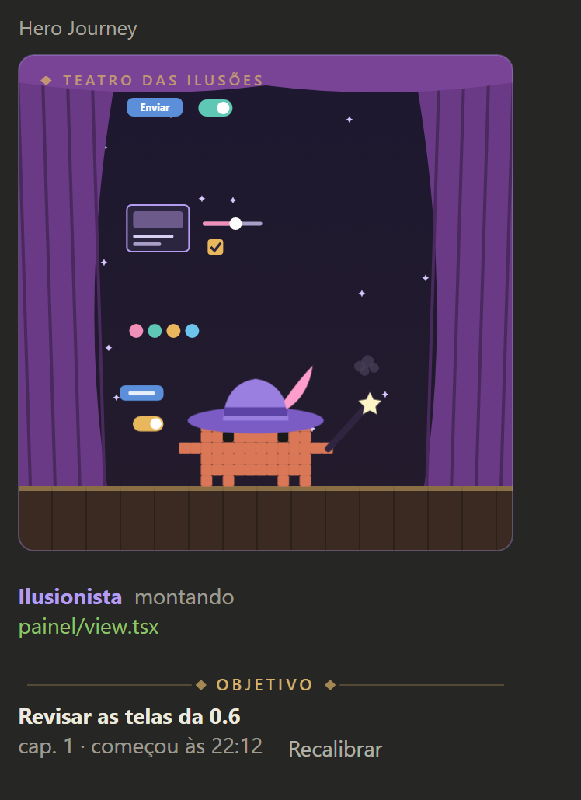<br><sub><b>Palco.</b> A classe em ação no cenário dela, quem age, o arquivo e o objetivo.</sub></td>
    <td width="60%">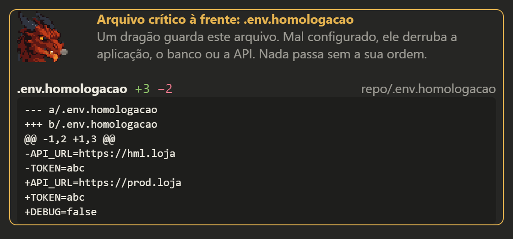<br><sub><b>Guarda.</b> O dragão barra um arquivo crítico e mostra a mudança antes da escolha.</sub></td>
  </tr>
  <tr>
    <td width="60%">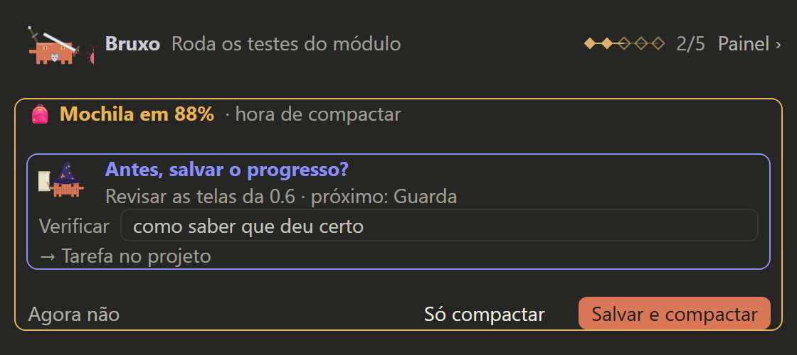<br><sub><b>Faixa e mochila.</b> Quem age e a trilha do plano; a mochila pesada oferece salvar o progresso e compactar.</sub></td>
  </tr>
  <tr>
    <td colspan="2">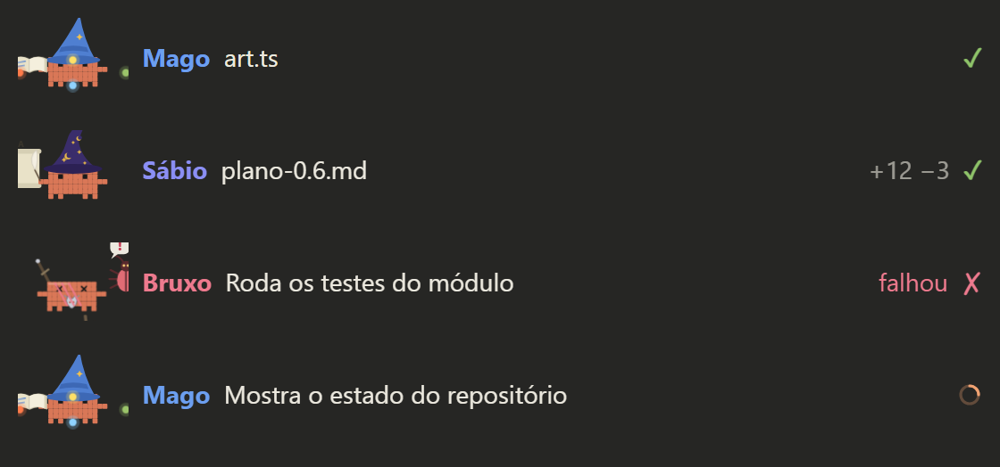<br><sub><b>Diário de bordo.</b> O Clawd da classe em cada ferramenta e o resultado à direita; na falha, ele tropeça.</sub></td>
  </tr>
</table>

<sub>Telas desenhadas pelo próprio mod, com dados de exemplo.</sub>

### No terminal

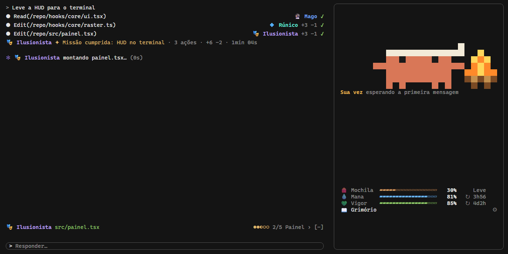

No Claude Code CLI a HUD usa o que o terminal desenha:

- **Os Clawds são pixel art feita para o terminal,** sem fundo, cada um com o que veste no desktop (chapéu, coroa, escudo, arco…). O palco aparece no painel encaixado ao lado da conversa (tela cheia, 110 colunas ou mais), grande com o painel livre e menor com plano, grupo ou inventário. O acampamento leva a fogueira, e o palco anima: o Clawd respira e a chama tremula.
- **Cada classe tem um ícone** (🔮 Mago, 🐺 Bruxo, 🎭 Ilusionista…) onde só cabe uma linha: na faixa, no diário (à direita da linha de cada ferramenta), no spinner e no recibo, que entra no lugar do "Baked for 3s".
- **Com um recurso em alerta,** ele aparece também no fim da linha de dicas embaixo do prompt.
- **O que muda em relação ao desktop:** sem o painel encaixado não há palco (o painel abre acima do prompt, só com texto); a guarda mostra 🐉 no lugar do dragão, porque o motor só aceita 12 linhas em volta do diálogo e não aceita pixels ali; o spinner é desenhado pelo mod e não mostra os tokens; os tooltips viram texto escrito.

## 🦀 O grupo

Os caranguejos **Clawd** em pixel art vestem **19 classes**, uma para cada tipo de tarefa do Claude, com roupa, acessório e cenário próprios, e duas poses: trabalhando e quando dá errado. A classe sai da ferramenta e do arquivo ou comando: `npm test` é Bruxo, `azure-pipelines.yml` é Artífice, `git push` é Rei e `git status` é Mago. O mapa completo está em [docs/classes.md](docs/classes.md).

<table>
  <tr>
    <td align="center" width="25%"><br><b>Aprendiz</b><br><sub>Pensa e responde · o principal</sub></td>
    <td align="center" width="25%"><br><b>Mago</b><br><sub>Lê e busca no projeto</sub></td>
    <td align="center" width="25%"><br><b>Caçador</b><br><sub>Pesquisa na web</sub></td>
    <td align="center" width="25%"><br><b>Ladino</b><br><sub>Navega em sites</sub></td>
  </tr>
  <tr>
    <td align="center" width="25%"><br><b>Rúnico</b><br><sub>Escreve código</sub></td>
    <td align="center" width="25%"><br><b>Ilusionista</b><br><sub>Telas e estilo</sub></td>
    <td align="center" width="25%"><br><b>Sábio</b><br><sub>Docs e textos · guarda o grimório</sub></td>
    <td align="center" width="25%"><br><b>Engenheiro</b><br><sub>Comandos de terminal</sub></td>
  </tr>
  <tr>
    <td align="center" width="25%"><br><b>Bruxo</b><br><sub>Testes, lint e tipos</sub></td>
    <td align="center" width="25%"><br><b>Rei</b><br><sub>Commit, PR e merge · fala com o mundo</sub></td>
    <td align="center" width="25%"><br><b>Artífice</b><br><sub>Pipeline, deploy e infra</sub></td>
    <td align="center" width="25%"><br><b>Oráculo</b><br><sub>Logs e monitoramento</sub></td>
  </tr>
  <tr>
    <td align="center" width="25%"><br><b>Geomante</b><br><sub>Banco de dados e migrações</sub></td>
    <td align="center" width="25%"><br><b>Alquimista</b><br><sub>APIs e integrações (MCP, HTTP)</sub></td>
    <td align="center" width="25%"><br><b>Cartomante</b><br><sub>Planos e tarefas</sub></td>
    <td align="center" width="25%"><br><b>Invocador</b><br><sub>Chama subagentes</sub></td>
  </tr>
  <tr>
    <td align="center" width="25%"><br><b>Cronomante</b><br><sub>Agenda e automatiza</sub></td>
    <td align="center" width="25%"><br><b>Paladino</b><br><sub>Segurança e revisão</sub></td>
    <td align="center" width="25%"><br><b>Pintor</b><br><sub>Design visual</sub></td>
  </tr>
</table>

<sub>As referências de jogos (D&D, World of Warcraft, The Witcher, Expedition 33, Tree of Savior, Final Fantasy XIV) e de Avatar são homenagens: quem veste cada classe é sempre o Clawd, sem nome nem logo deles no produto.</sub>

Quando o Claude para, o Aprendiz volta ao **acampamento**:

<table>
  <tr>
    <td width="50%"><br><sub><b>Acordado:</b> o turno acabou e é a sua vez.</sub></td>
    <td width="50%"><br><sub><b>Dormindo:</b> a sessão está parada há alguns minutos.</sub></td>
  </tr>
</table>

No inventário, cada arquivo tem raridade pelo impacto, e clicar nele abre o diff:

| Raridade | Arquivo |
|---|---|
| 🟧 **Lendário** | Protegido |
| 🟦 **Raro** | Criado |
| 🟩 **Incomum** | Modificado |
| ⬜ **Pobre** | Excluído |

## 🚀 Instalação

> [!NOTE]
> Requer o **app desktop do Claude Code**, com mods (function hooks) ligados. Os testes rodam no motor 2.1.295; versões mais antigas podem recusar partes da tela.

**No Windows, pelo clone local** (PowerShell; roda os testes antes de instalar):

```powershell
git clone https://github.com/soulrocha/Claude-code-hero-journey.git
cd Claude-code-hero-journey
powershell -ExecutionPolicy Bypass -File scripts\instalar.ps1 -Lingua pt-BR
```

Com vault: acrescente `-Vault` com o caminho dele e, se quiser outra pasta de entrada que não `Inbox`, `-VaultInbox` com o nome da subpasta.

**Pelo marketplace:**

```
/plugin install hero-journey --marketplace soulrocha/Claude-code-hero-journey
```

Instalado pelo terminal no escopo de usuário, o mod também carrega nas sessões do app desktop. Depois, digite **`/hero`**.

**Vindo da v0.4 (`clawd-hud`)?** O plugin mudou de nome. Remova o antigo antes, para não ficar com duas HUDs e dois guardas: `claude plugin uninstall clawd-hud@claude-code-hero-journey`. O `scripts\instalar.ps1` já faz isso sozinho.

**O que a instalação pergunta.** As opções do mod são as perguntas abaixo. Todas podem ficar vazias. Para responder:
- **dentro do Claude Code:** `/plugin configure hero-journey@claude-code-hero-journey`;
- **pelo terminal:** `claude plugin install hero-journey@claude-code-hero-journey --config vaultPath=C:\Notas --config vaultInbox=Inbox --config language=pt-BR`, ou depois `claude plugin configure hero-journey@claude-code-hero-journey`.

A instalação pelo terminal não faz as perguntas sozinha: ela só avisa quais opções ficaram sem valor. Depois de mudar uma opção, reinicie o Claude Code.

| Pergunta | Se você usa | Se não usa |
|---|---|---|
| Língua da HUD | `auto`, `pt-BR` ou `en` | deixe `auto` |
| Você usa um vault (Obsidian)? | o caminho, ex.: `C:\Notas` | deixe vazio |
| Pasta de entrada no vault | a subpasta onde as notas novas caem | deixe vazio: escolhendo o vault pelo painel, ela vem sozinha (`00-Inbox` se existir, senão `Inbox`) |
| Protegidos extras / Sempre liberados | globs separados por vírgula | deixe vazio |

O ai-memory não pede pasta: o grimório grava nele pelo MCP, quando o MCP está conectado (veja [a seção dele](#-memória-de-longo-prazo-com-o-ai-memory)).

**Primeiros passos.** Na primeira vez que o painel abre, ele diz que tudo já funciona e pergunta só a língua. Embaixo, mostra o que encontrou para a memória:
- **Vault:** a pasta, se já estiver configurada, ou **📁 Escolher pasta**, que abre o seletor de pastas do sistema (a pasta é conferida antes de salvar, e a pasta de entrada vem sozinha). O campo para digitar o caminho só aparece se o seletor não abrir.
- **ai-memory:** "conectado", com um convite a apoiar o Fabio Akita, ou "não encontrado", com o link para conhecer o [ai-memory](https://github.com/akitaonrails/ai-memory).

Nada ali é obrigatório: sem vault e sem ai-memory, o progresso e as decisões ficam no próprio projeto, e o grimório pergunta quando precisar. Dá para voltar à tela pelo ⚙ → Primeiros passos.

<details>
<summary><b>Rodar direto da pasta, durante o desenvolvimento (Windows, app desktop)</b></summary>

1. Clone o repositório.
2. Em `%USERPROFILE%\.claude\settings.json`, no bloco `"env"`, aponte para a pasta do mod no seu clone:
   ```json
   "CLAUDE_CODE_PLUGIN_DIRS": "C:\\caminho\\do\\clone\\mods\\hero-journey",
   "CLAUDE_CODE_PLUGIN_DIR_WATCH": "1"
   ```
3. Reinicie o app e digite `/hero`. Cada arquivo salvo recarrega o mod.

</details>

## ⚙️ Configuração

**Em `/config`:**

| Opção | Padrão | Para quê |
|---|---|---|
| `language` | `auto` | Segue a língua do Claude; `pt-BR` ou `en` fixam |
| `protect` | — | Globs extras protegidos, separados por vírgula |
| `allow` | — | Globs que o guarda nunca bloqueia (os modelos `.env.example`, `.env.sample` e `.env.template` já vêm liberados) |
| `vaultPath` | — | Pasta do vault, para os destinos do grimório e da carreira |
| `vaultInbox` | `Inbox` | Subpasta do vault onde o grimório deixa as notas novas |

**No ⚙ do painel** (guardado entre sessões), em duas categorias: **Geral** (língua e estilo) e **Recursos** (cada módulo, agrupado por onde aparece; embaixo do Grimório, o **⚙ Memória ›**; embaixo da Guarda, o modo: **Perguntar** ou **Só avisar**). Primeiros passos e Sobre ficam no pé; o Sobre mostra as 19 classes, com o que cada uma faz ao passar o mouse. No **⚙ Memória** (também pelo 📖): cada recurso e aviso do grimório, onde as decisões caem, as integrações (vault e ai-memory) e o botão do Haiku.

> [!NOTE]
> **E a barra lateral do app?** A API de mods não deixa mudar a barra lateral nativa: ela não está entre os componentes que um mod redesenha, e não há chamada para renomear ou agrupar sessões.

Detalhes de cada módulo, os limites conhecidos e a estrutura do código estão no [README do mod](mods/hero-journey/README.md).

## 🔒 Tokens e privacidade

- **Desenhar, ler o git, os timers e os grupos não chama o modelo.** Só três coisas gastam tokens, e só quando você clica: **Compactar agora** (mochila), **✦ Recalibrar objetivo** (painel, pelo Haiku) e **✦ Resumir com Haiku** (grimório, botão opcional que vem desligado).
- **O grimório não grava nada sem o seu clique em Selar,** e o que foi selado dá para desfazer. Só uma regra que você mesmo estabeleceu ("a partir de agora…") vai para o `AGENTS.md`, numa linha só, sem crase nem tag. Um texto que cite o vault ou um caminho pessoal nunca vai para o repositório.
- **Nota nunca sobrescreve nota:** se o nome já existe, a nova ganha `-2`, `-3`… E uma inscrição que não gravou em lugar nenhum continua pendente, com o motivo no aviso.
- **Sem vault e sem ai-memory,** tudo funciona com o projeto: a tarefa em `.hero/tarefas/` (fora do git, com um `.gitignore` próprio), as decisões em `docs/decisoes` (a primeira pergunta antes) e as regras no `AGENTS.md`.
- **O guarda falha fechado:** se a checagem quebrar, a edição é bloqueada.
- **Recursos e recibo não gastam nada:** os números vêm do próprio Claude Code (`$.session.usage()`), e o detalhe da mochila é estimado localmente, sem chamada de contagem de tokens.

## 🧠 Memória de longo prazo com o ai-memory

O grimório usa o [**ai-memory**](https://github.com/akitaonrails/ai-memory), de **Fabio Akita** ([@akitaonrails](https://github.com/akitaonrails)), sob licença MIT. Ele dá memória de longo prazo aos agentes de código: guarda o que acontece nas sessões, devolve o contexto certo na sessão seguinte e passa o trabalho entre agentes (Claude, Codex, Antigravity e outros) e entre PCs. Obrigado, Akita, por abrir o projeto. Se o ai-memory te ajudar, apoie: dê uma estrela [no repositório dele](https://github.com/akitaonrails/ai-memory) e conte para quem usa agentes de código.

**A estrutura recomendada.** É a que a pesquisa e a documentação das próprias ferramentas apontam para quem usa mais de um agente:
- **`AGENTS.md`** com as regras de cada projeto, curto: Codex, Antigravity e Claude Code leem o mesmo arquivo;
- **a tarefa num arquivo** (objetivo, próximo passo, como verificar, o que falhou e um log), que qualquer agente retoma;
- **o ai-memory** para o que o agente lembra sozinho e para o handoff entre ferramentas e PCs;
- **um vault do Obsidian** para o que você revisa: decisões, resultados e carreira.

Com o vault e o ai-memory detectados, o ⚙ Memória mostra "✓ Estrutura recomendada detectada" e o grimório já vem configurado. Sem eles, tudo funciona com o projeto; cada integração é sugerida quando faz falta.

**Como a HUD conversa com ele.** Pelo MCP, do jeito que a documentação do ai-memory recomenda para ferramentas externas:
- **Salvar progresso** grava a tarefa e abre um handoff (`memory_handoff_begin`) com o próximo passo e o que falta do plano;
- **Continuar**, no acampamento, lista os handoffs pendentes (`memory_handoff_list`) junto com as tarefas do projeto, e pega o escolhido (`memory_handoff_accept`);
- uma **decisão** ou uma **conquista** vai para o ai-memory só se você trocar o destino para ele: vira uma página do projeto, em `decisions/` ou `notes/`, com a hora no nome;
- **O que o Sábio lembra** mostra as páginas recentes (`memory_recent`), e o "esquecer" as marca como velhas (`memory_feedback`), para memória ruim não piorar o agente;
- as suas preferências o próprio ai-memory aprende, no perfil: a HUD não detecta nem grava preferência.

Se o vault também for um projeto do ai-memory, use o `ignore_paths` do `.ai-memory.toml` para deixar as pastas sensíveis fora da captura.

## 🧩 Como funciona

A HUD é um **mod** do Claude Code: um plugin de *function hooks*, em que cada hook recebe o evento, decide e passa adiante.

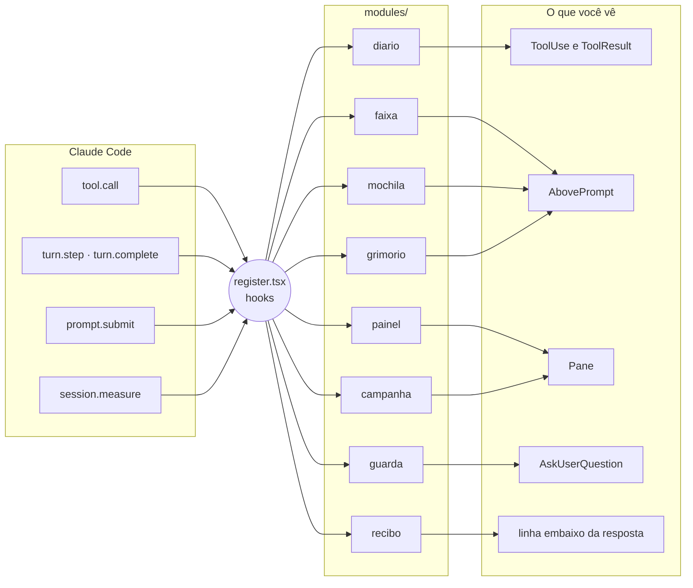

- **Um arquivo liga tudo:** todo código que usa `$` (a interface do motor) fica em `register.tsx`, porque o motor recusa o `$` passado para uma função importada ("$ is followed only into a function declared in this same file"). Conferido no motor 2.1.295.
- **Cada módulo tem a sua pasta**, com a lógica pura em `<módulo>.ts` e a tela em `view.tsx`.
- **A arte é texto de SVG** animado com CSS e SMIL, sem script: é o que o `Svg` interativo do desktop desenha.

<details>
<summary><b>Estrutura do repositório</b></summary>

```
.
├── mods/
│   ├── hero-journey/            # a HUD (o mod)
│   │   ├── hooks/
│   │   │   ├── register.tsx  # liga os módulos aos eventos
│   │   │   ├── core/         # arte, textos pt/en, classes, preferências
│   │   │   └── modules/      # diario, faixa, painel, campanha, recibo, mochila
│   │   │                     # (com os recursos), guarda, grimorio
│   │   ├── tests/            # 145 testes no motor (desktop e terminal)
│   │   └── types/            # contrato do $.state
│   └── clawd-hud-spike/      # sondas para validar a API no app real
├── docs/                     # imagens do README e o estilo de saída briefing-de-bordo
├── scripts/                  # instalar, verificar, gerar assets
└── .claude-plugin/           # marketplace
```

</details>

## 🛠️ Desenvolvimento

```sh
# Valida e testa tudo (não gasta tokens)
./scripts/verificar.sh                                       # macOS/Linux
powershell -ExecutionPolicy Bypass -File scripts\verificar.ps1   # Windows

# Regenera o banner, os Clawds das classes, o acampamento e a demo
bun run scripts/gerar-assets.ts
bun run scripts/gerar-demo.ts
```

São 145 testes da HUD e 5 do spike. Eles rodam no motor do próprio Claude Code (`claude plugin test`), nas superfícies desktop e terminal, e incluem regressões para cada achado do QA adversarial e da revisão do PR. A demo e as telas da galeria são desenhadas a partir da arte do próprio mod.

Quer contribuir? Leia o [CONTRIBUTING](CONTRIBUTING.md). Achou uma falha de segurança? Siga a [política de segurança](SECURITY.md). As mudanças de cada versão estão no [CHANGELOG](CHANGELOG.md).

## 🗺️ Status e roadmap

> [!IMPORTANT]
> **1.0, estável.** Tudo passa no validador e nos testes do motor, e a HUD foi testada à mão no app desktop. O spike (`mods/clawd-hud-spike`) continua sendo o lugar de confirmar no app real o que os testes não alcançam, como a animação dos Svgs e o rodapé fixo.

- [x] Desenho: protótipos v1 a v6 e o final, validados por UX e por QA adversarial
- [x] Fase 0: spike com as sondas dos 12 itens a validar
- [x] Fase 1: diário, faixa e painel, sem tokens
- [x] Fase 2: campanha e guarda dos protegidos (o relatório da missão saiu do painel na revisão de 2026-10-09)
- [x] Fase 3: grimório, mochila com compactação, side quest e comemoração (side quest e comemoração saíram na simplificação de 2026-10-10)
- [x] Português e inglês, módulos que ligam e desligam, QA adversarial com correções
- [x] Primeiros passos, licença MIT
- [x] Correções da revisão do PR: guarda do terminal, inventário com `-z`, grimório sem sobrescrita e ai-memory pelo MCP
- [x] Simplificação (2026-10-10, [escopo](docs/escopo.md)): saíram Projetos, Side quest, o agrupamento do diário, os perfis do painel e o código do relatório; as três artes viraram uma
- [x] Recursos aprimorados: Mochila contra o ponto de compactação, estado em palavras, peso do último turno (no tooltip), contagem que anda, avisos e ritmo da Mana e do Vigor, rodapé preso no fim
- [x] Recibo do turno no lugar do relatório e da comemoração, sem tokens
- [x] A HUD volta certa depois de `/clear`, `/resume` e `/branch`
- [x] Vault com o seletor de pasta do sistema e o atalho para a pasta das decisões
- [x] 0.6: 19 classes, uma por família de tarefa ([mapa](docs/classes.md)), cada uma com o Clawd sem fundo (trabalho e falha) e o seu cenário; o Aprendiz e o acampamento
- [x] 0.6: painel com o palco no topo e seções só com conteúdo; faixa em uma linha; spinner com a classe; diário só com o pet
- [x] 0.6: grimório novo: salvar progresso e continuar, crônica, regras no AGENTS.md, ⚙ Memória e a estrutura recomendada detectada sozinha
- [x] 0.6: telas revisadas: Primeiros passos sem pergunta de pasta, ⚙ em Geral e Recursos, Sobre com as 19 classes, guarda com o dragão vermelho e lista curta de protegidos, diário sem o trilho do app, tema claro conferido
- [x] 0.6: teste no app, revisão de qualidade, demo nova e a versão 0.6.0
- [x] 0.7: a HUD no Claude Code CLI (terminal): os 19 Clawds em pixel art própria, o palco animado no painel, o ícone de cada classe na faixa, no diário, no spinner e no recibo
- [x] 0.7: grimório mais firme (Selar que não trava, nota sem duplicata) e compactar mais claro
- [x] 1.0: teste manual no app desktop, com os ajustes do resultado
- [x] 1.0: diff no inventário
- [x] 1.0: primeira versão estável

## 🙏 Créditos e referências

O código da HUD é próprio, mas não nasceu do nada.

**Padrões de código.** Alguns padrões vieram dos mods do [**claude-code-templates**](https://github.com/davila7/claude-code-templates), de **Daniel (San) Ávila**, sob licença MIT. Cada módulo cita o padrão de origem no cabeçalho, e o aviso da licença está em [`THIRD_PARTY_NOTICES.md`](mods/hero-journey/THIRD_PARTY_NOTICES.md).

| Mod de origem | O que inspirou |
|---|---|
| [protected-paths-guard](https://github.com/davila7/claude-code-templates/tree/main/cli-tool/components/mods/security/protected-paths-guard) | Os globs e o guarda que falha fechado |
| [large-edit-confirmation](https://github.com/davila7/claude-code-templates/tree/main/cli-tool/components/mods/security/large-edit-confirmation) | Perguntar pelo diálogo antes de editar |
| [tool-timing-badge](https://github.com/davila7/claude-code-templates/tree/main/cli-tool/components/mods/ui/tool-timing-badge) | Embrulhar a linha de ferramenta |
| [agent-flow](https://github.com/davila7/claude-code-templates/tree/main/cli-tool/components/mods/ui/agent-flow) | Acompanhar os subagentes |
| [git-sidebar](https://github.com/davila7/claude-code-templates/tree/main/cli-tool/components/mods/ui/git-sidebar) | Git sem shell, no inventário |
| [session-time-machine](https://github.com/davila7/claude-code-templates/tree/main/cli-tool/components/mods/productivity/session-time-machine) | A linha do tempo da sessão |

**Mods que combinam com a HUD.** Instale do repositório de quem fez: [secret-redactor](https://github.com/davila7/claude-code-templates/tree/main/cli-tool/components/mods/security/secret-redactor) e [prompt-cache-control](https://github.com/davila7/claude-code-templates/tree/main/cli-tool/components/mods/observability/prompt-cache-control). Para passar uma sessão longa para outra, o [ctx-handoff](https://github.com/cablate/ctx-handoff-mod) e o [claude-auto-handoff](https://github.com/alexknowshtml/claude-auto-handoff) fazem o que a side quest fazia.

**Referências.**
- Documentação de mods do Claude Code: [code.claude.com/docs/en/plugins/mods/overview](https://code.claude.com/docs/en/plugins/mods/overview)
- Exemplos oficiais: [anthropics/claude-code · mods](https://github.com/anthropics/claude-code/tree/main/mods)
- [ai-memory](https://github.com/akitaonrails/ai-memory), de Fabio Akita: a memória de longo prazo e o handoff entre agentes do grimório
- [Tabler Icons](https://tabler.io/icons), usados no protótipo
- A estética de quest log vem de World of Warcraft, Baldur's Gate 3 e Diablo

> [!NOTE]
> Projeto de fã, **sem afiliação com a Anthropic**. O Clawd é o mascote do Claude Code; aqui ele só ganhou chapéus e acessórios. World of Warcraft, Baldur's Gate 3 e Diablo pertencem aos seus donos e aparecem só como inspiração.

## 👤 Autor

Feito por **Saulo Rocha**, desenvolvedor (Angular, .NET e Azure DevOps).

**Do mesmo autor:** [SnapMD](https://github.com/soulrocha/snapmd), extensão para Chrome e Edge que transforma a página aberta (estado dos formulários, grids, terminais, modais) em Markdown pronto para a LLM. O mascote do popup é o Ladino deste projeto.

[](https://www.linkedin.com/in/soulrocha)
[](https://github.com/soulrocha)

## 📄 Licença

[MIT](LICENSE) © 2026 Saulo Rocha. Os trechos adaptados do claude-code-templates mantêm o aviso MIT original em [`THIRD_PARTY_NOTICES.md`](mods/hero-journey/THIRD_PARTY_NOTICES.md).

<div align="center">
<br>
<sub>🦀 ✦ Boa jornada, herói.</sub><br>
<sub>Se a Hero Journey deixou suas sessões mais divertidas, uma ⭐ ajuda outros aventureiros a encontrá-la.</sub>
</div>
